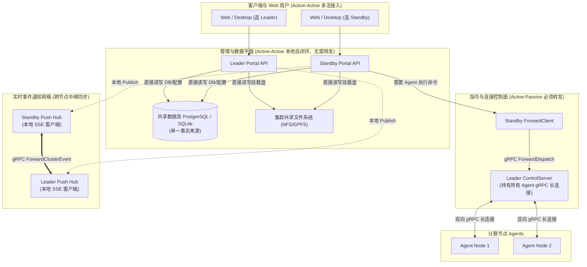
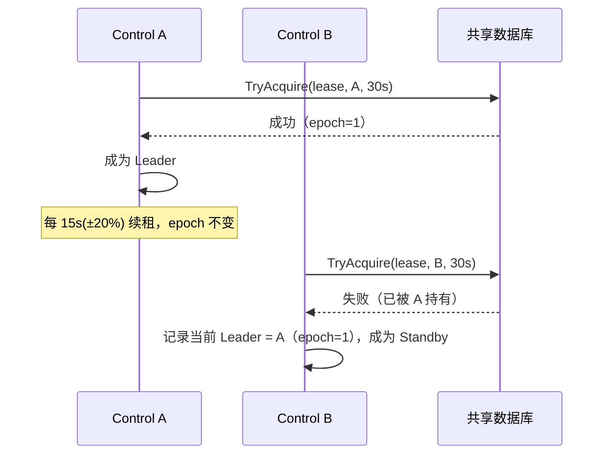
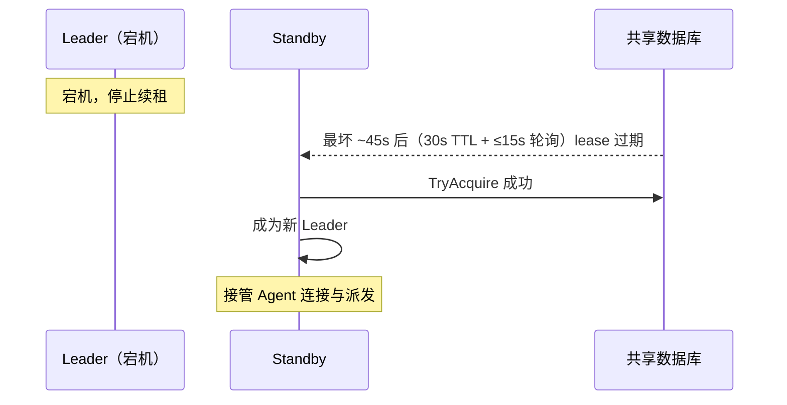
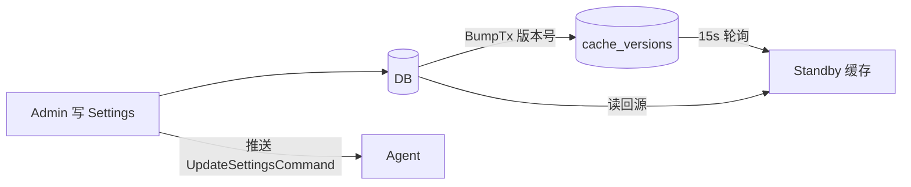
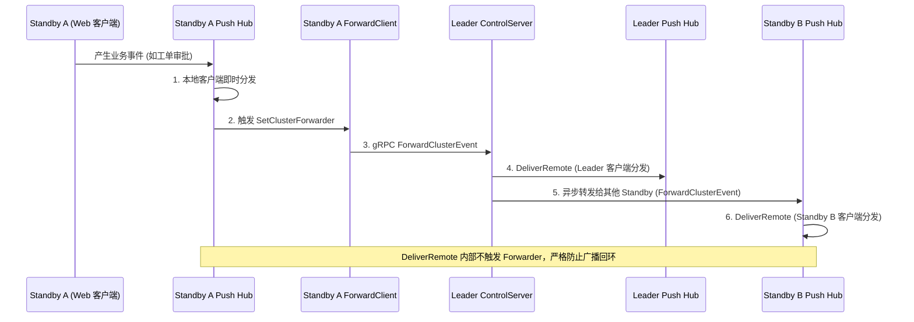

> 本文档系统介绍多 Control 节点（主备）部署下的拓扑、Leader 选举、Agent 连接重定向、
> 请求转发、故障切换与配置同步机制。实现位于 `internal/server/controlplane/` 与 `internal/server/cache/cache.go`。

## 拓扑与角色

### 配置

在 `config.toml` 的 `cluster.servers` 列表中声明多台集群 Server：

```toml
[cluster]
servers = [
  "cn01",                # 集群 Server；元素支持模式展开，如 "cn01", "node[02-03]"
  "cn02",
  "cn03",
]
```

所有匹配 `servers` 项的节点都会启动 Server 角色（Portal + ControlServer）。
多个集群 Server 共享同一个数据库，构成主备（Leader/Standby）集群。

### 角色职责

| 角色 | 职责 |
|------|------|
| **Leader** | 持有所有 Agent 的活跃 gRPC 会话；直接派发任务；接收 Agent 状态上报；读写 DB；广播 Push 事件至 Standby |
| **Standby** | 不直接连接 Agent；接收到的派发请求通过 `ForwardClient` 转发给 Leader；Portal API 全功能服务（直读直写 DB）；向 Leader 同步本地 Push 事件 |

> 只有 Leader 持有 Agent 的活跃 gRPC 会话。Standby 节点的 `AgentRegistry` 通常为空。

---

## 分面治理架构 (Split-Plane Architecture)

DCE 采用经典的**“管理面多活 (Active-Active) + 控制面主备 (Active-Passive)”**分面治理架构：



### 转发与非转发判定矩阵（第一性原理）

系统判定一个操作是否需要跨节点转发，遵循资源所在的底层物理位置：

| 资源所在位置 | 典型业务场景 | 处理模式 | 架构设计考量 |
|:---|:---|:---:|:---|
| **持久化数据 (DB / 共享文件)** | 用户登录认证、密码修改、工单审批、审计日志查询、平台配置修改、应用与桌面连接历史 | **本地直达**<br>(无需转发) | 数据在共享 DB 或共享存储中。所有 Control 节点地位均等，本地直连链路最短、延迟最低、具备原生 ACID 事务保障。 |
| **独立数据拉取流 (DB-backed Pull Stream)** | 看板状态监控 (`/api/overview/stream`)、本地运行日志拉取 | **本地直达**<br>(无需转发) | 每个节点直接拉取共享 DB 聚合采样并经 `cache.Cell` 缓存下发，不依赖其他节点。 |
| **物理网络连接 (TCP Socket)** | 提交/取消 HPC 作业、启动/停止图形会话、计算节点探针收集、远程进程管理 | **请求转发**<br>(Standby $\to$ Leader $\to$ Agent) | 计算节点 Agent 仅与 Leader 维持 gRPC 长连接。Standby 内存中无该 Agent 的 Socket，必须委托 Leader 代理下发。 |
| **多节点内存状态 (SSE 客户端)** | 节点上下线通知、作业完成弹窗、实时工单状态刷新 (`/api/events`) | **事件中继**<br>(双向中继广播) | 客户端分散连接在各节点的 `push.Hub` 中，本地触发事件后通过 `ForwardClusterEvent` 扩散到其他节点，并带有防回环保护。 |

---

## Leader 选举（DB Lease）

Leader 选举**不是共识算法**，而是基于共享数据库租约（Lease）的"先获取者赢"机制，
实现在 `internal/server/controlplane/leader/leader.go`。

```text
LeaseTaskName  = "cluster_server_control_leader"
LeaseTTL       = 30s    # 租约有效期（默认；cluster.lease_ttl 可覆盖）
RenewInterval  = 15s    # 续租周期（默认；cluster.renew_interval 可覆盖），实际节拍带 ±20% 抖动
```

### 租约 epoch（fencing token）

`task_leases` 行携带单调递增的 `epoch`，用于识别"过期的 Leader 视图"：

- **仅存活续约不递增**：同一 Owner 在租约存活期内续约，epoch 不变（否则每 15s 变更一次，在途请求的 fencing 校验全部失效）；
- **其余获取路径一律 +1**：新建行、新 Owner 抢占、**同 Owner 跨过期重获**——Owner 在"租约已过期但尚未察觉"的窗口内仍以旧 epoch 签发命令，若重获后 epoch 不变，这些旧命令会继续被视为有效；
- `TryAcquire` 在同一事务内完成判定与 epoch 递增并返回新 epoch；
- Elector 暴露两个视角：`LocalEpoch()`（自己持约的 epoch，仅 Leader 有意义，服务端校验用）与 `LeaderEpoch()`（refresh 时从租约行观测到的对端 epoch，Standby 转发时填入请求）。

### 流程



### 关键点

- **数据库时间**：到期判断使用 `GetDatabaseTime()` 而非本地时钟，避免节点间时钟漂移导致误判
- **续租**：Leader 每 15s（±20% 抖动，避免多节点同拍造成 DB 行锁争用）续租一次，维持 `leaseDeadline = dbNow + 30s`
- **降级即自隔离**：若续租失败且 `dbNow > deadline`，Leader 主动降级为 Standby，并由降级钩子（`HandleLeaderDemotion`）同步执行：使全部在途派发立即失败（`FailAllPendingRequests`）→ 向所有已注册 Agent 发送 `RedirectCommand("leader_demoted")` → 断开连接，引导 Agent 主动迁移
- **优雅释放**：`Stop()` 时通过 `ReleaseIfOwner` 主动释放租约，加快切换
- **参数可配**：`cluster.lease_ttl` / `cluster.renew_interval`（秒，0 表示默认 30/15，校验要求 renew < ttl）。要求更快故障切换可调至 15s/5s，代价是 DB 写频率提升约 3 倍

## Agent 连接与重定向

Agent **只连接 Leader**。连接管理依赖两类重定向：

### 1. 注册时重定向（Standby 收到注册）

```text
Agent → Standby 注册
Standby 非 Leader
  → 返回 RegisterResponse: leader_node_id / leader_addr
Agent → 重连到 Leader 注册
```

### 2. Leader 降级时主动断开（降级钩子）

```text
Leader 检测到租约过期/失败 → 降级为 Standby
  → 降级钩子 HandleLeaderDemotion：
      1) FailAllPendingRequests —— 在途同步派发立即失败（而非挂起到超时）
      2) 向全部 Agent 发送 RedirectCommand("leader_demoted"，携带新 Leader 地址)
      3) 断开全部 Agent 连接
Agent 收到重定向 → 重连到新 Leader
```

Agent 侧重连采用指数退避（`minReconnectDelay=2s` → `maxReconnectDelay=60s`），
见 `internal/agent/stream.go`。

## 请求转发（Standby → Leader）

Standby 节点接收到需要派发的请求时，由本地 `Dispatcher` 通过 `ForwardClient`
转发给 Leader（`internal/server/controlplane/forward.go`）：

```text
Standby Portal → Standby Dispatcher → ForwardClient → ForwardDispatch gRPC
  → Leader ControlServer → Agent
```

1. `Dispatcher` 检测本节点非 Leader（当前 Leader 记录在共享数据库）
2. `ForwardClient` 以 Standby 观测到的 `leader_epoch` 构造 `ForwardDispatchRequest`，通过 gRPC 传递给 Leader
3. Leader 按路由策略选择 Agent 执行，结果沿调用链原路返回

### fencing 校验与有界重试

- **服务端 fencing**：Leader 收到转发请求时校验——非 Leader、`leader_epoch` 与自身 `LocalEpoch()` 不符、或 `hop >= 1`，一律以 gRPC `FailedPrecondition` 拒绝；无 deadline 的调用以 `InvalidArgument` 拒绝（客户端未带 deadline 时自动补 5s 兜底），避免请求挂死。`hop` 由转发客户端固定填 `0`（Standby → Leader 一跳，`0` 是唯一合法入站值）；
- **同批升级**：同一集群的 Portal 控制面必须一起换成带 `leader_epoch` 的二进制。不做旧字段兼容：滚动期间旧 Standby 送出的 epoch 为 0，新 Leader 会以 `FailedPrecondition` 拒绝转发，直到全部节点升级完成；
- **客户端有界重试**：转发失败且错误为 `Unavailable` / `DeadlineExceeded` / `FailedPrecondition` 时，先 `RefreshNow` 主动刷新 Leader 视图（可能已切换），再以新的 LeaderID/epoch 重试 **1 次**；`InvalidArgument` 等确定性错误不重试；
- **最终失败**：重试仍失败时按 `execution_id` 回查 DB（转发可能已到达 Leader 并执行，幂等覆盖全部运行模式），查无结果则返回 503（`Unavailable`）；
- **幂等保证边界**：以上保证"服务端转发重试不重复执行"。HTTP 客户端重试会生成全新 `execution_id`，语义为 at-least-once（见[执行幂等性](idempotency.md)）。

## 故障切换



### 切换时间线

| 事件 | 耗时 |
|------|------|
| Leader 宕机，停止续租 | 0s |
| 原租约过期（`LeaseTTL`） | 30s |
| Standby 轮询发现可获取（`RenewInterval` ±20% 抖动粒度） | ≤15s |
| **最坏切换延迟**（默认参数） | **~45s** |

> 切换后，原 Leader 已连接的 Agent 会因 gRPC 流断开自动重连到新 Leader；
> 若是优雅降级，则通过 `RedirectCommand` 主动引导，更快收敛。
>
> 接管行为有自动化演练覆盖：`internal/server/controlplane/leader/takeover_test.go`
> 模拟 Leader 崩溃（不释放租约），断言 Standby 不得在 TTL 内抢占、过期后接管且 epoch +1。

## 故障语义表

| 场景 | 期望行为 |
|---|---|
| Leader 进程崩溃 | ≤ TTL 后其他节点接管（epoch +1）；期间新注册返回 `standby server`；Agent 自动重连 |
| Leader 与 DB 失联 | refresh 失败；deadline 到期后自我降级并断流（降级钩子）；期间写操作快速失败 |
| 网络分区（旧 Leader 存活） | 旧 Leader 无法续约 → 到期降级 → 主动断流；新 Leader 以 epoch 拒绝旧请求（`FailedPrecondition`） |
| DB 不可用 | 控制面写路径快速 503（不挂起）；读路径视缓存可用性降级 |
| Standby 转发失败 | 有界重试（1 次，先刷新 Leader 视图）+ 最终 503；服务端重试按 `execution_id` 幂等；客户端重试为 at-least-once（HTTP 幂等键为独立决策项） |
| 事件重复投递 | 接收端按 `event_id` 去重；超 TTL（`expires_at`）事件丢弃 |

## 配置同步（Invalidator 轮询）

多个 Server 节点各自维护一份 Settings 内存缓存。为保证 standby 接管时缓存不陈旧，
使用 `internal/server/cache/cache.go` 的 `Invalidator` 做跨节点失效：

```go
// settings.go: NewService
invalidator.Register("settings", func() {
    s.cache.Clear()  // 版本变化 → 清缓存
})
```

- **写节点**：`UpdateByDomain` 写 DB 时 `BumpTx` 自增版本号 + 本地 `cache.Invalidate(d)` 即时生效
- **其他节点**：`Invalidator` 单 goroutine 按统一节拍（15s）拉取整张 `cache_versions` 表，检测到版本增长 → 触发该主题全部回调（同主题多回调累加，不再互相覆盖）→ 下次读取回源 DB
- **单节点模式**：`Invalidator.Start(ctx, len(Controls) <= 1)` 在单 Control 部署时禁用轮询



### Agent 配置下发（推送）

全局设置 `PUT /api/admin/system/settings/:domain` 写库并合并通知后，Server 装配层通过
`subscribeAgentSettingsPush` 订阅 `settings.Service.SubscribeDomains`：仅当变更域属于
`agent` / `storage` / `license` / `scheduler` 时调用 `SettingsPusher.Broadcast`，向所有在线 Agent 下发 `UpdateSettingsCommand`（异步、合并串行，与 `settings.md` 一致）。

```text
UpdateByDomain 写 DB
  → scheduleSubscriberNotify（合并串行）
    → SubscribeDomains 回调
      → agent/storage/license/scheduler ? SettingsPusher.Broadcast
      → 遍历在线 Agent → UpdateSettingsCommand → Agent 内存更新
```

节点级稀疏覆盖仍走 `PushNodeSettingsUpdate`（单节点）；Standby 场景见上文 `ForwardClusterEvent`。

## 跨 Control 节点 Push 消息广播网格

在多 Control 节点拓扑下，前端 Web/桌面客户端可能分别连入 Leader 或不同的 Standby 节点。为了让任一节点产生的业务事件（如工单审批、节点上下线、作业完成）能够无延迟触达所有客户端，系统通过 gRPC 控制平面实现了双向事件中继：



- **Standby 产生事件**：本地 `push.Hub` 投递给本地连接的客户端，同时通过 `ForwardClient` 异步转发给 Leader；
- **Leader 产生/接收事件**：Leader 本地投递后，遍历集群配置中的其他 Standby 节点并行广播；
- **防回环保护**：通过 `DeliverRemote` 接收远端事件，仅在本地内存 `Client` 通道分发，不再次触发 `ClusterForwarder`；
- **事件去重**：发送端为每个事件生成全局唯一 `event_id` 与 `expires_at`（TTL 30s）。接收端维护短期去重集合（内存 TTL + 容量上界 FIFO），同一 `event_id` 只处理一次——覆盖"变更节点直发 + Leader 二次扇出"双路径与关键事件失败重试造成的重复送达；超 TTL 事件直接丢弃。进程重启后集合丢失可接受，事件本身的 TTL 使重启窗口内的重复投递随过期自然收敛；
- **hop 上限**：`ForwardClusterEventRequest.hop` 上限 1（Leader 二次扇出时递增），是防御性防环冗余，现有 Leader-gated 拓扑本就无环；
- **关键事件重试**：`cluster:node_overrides_updated` 等关键事件扇出失败时重试 1 次并记录 WARN，避免静默丢失；
- **单机开发模式**：当集群仅配置单 Control 节点时（`len(Controls) <= 1`），自动跳过跨节点网络调用，保持零开销。

## 推荐部署拓扑

```text
                ┌──────────────┐
                │  PostgreSQL   │  共享数据库（唯一事实来源）
                └──────┬───────┘
                       │
        ┌──────────────┼──────────────┐
        │              │              │
  ┌─────┴─────┐  ┌─────┴─────┐  ┌─────┴─────┐
  │  cn01     │  │  cn02     │  │  cn03     │
  │ (Leader)  │  │ (Standby) │  │ (Standby) │
  │ Portal    │  │ Portal    │  │ Portal    │
  │ Control   │  │ Control   │  │ Control   │
  └─────┬─────┘  └───────────┘  └───────────┘
        │ gRPC (Agent 只连 Leader)
   ┌────┴────┐
   │ Agents  │  计算节点（Agent 角色）
   └─────────┘
```

- 管理节点（`controls` 列表）承担 Server 角色，计算节点承担 Agent 角色
- Agent 经负载均衡/首连任一 Control，注册后被重定向到当前 Leader
- 单机开发：单 Control（`len(Controls) <= 1`），轮询与选举降级为本地直连
