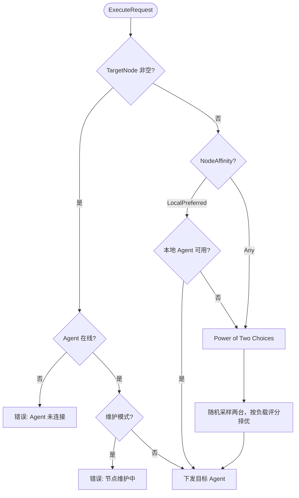

`Dispatcher` 是 Control 平面将业务层请求路由到具体 Agent 的核心组件，实现在 `internal/server/controlplane/dispatch.go`。

> 本文描述的是 Engine 内部集群的任务指派逻辑（"派给哪个 Agent"），与 LSF/Slurm 等外部作业调度器的资源排队策略无关。

## 调用路径

```
Business Service → Dispatcher → [ForwardClient if standby] → Control gRPC → Agent Executor
```

## 路由策略

### 决策流程



### 1. 显式目标路由（TargetNode）

**触发条件**：`ExecuteRequest.TargetNode` 非空。

**行为**：

1. 检查目标 Agent 是否已注册并在线
2. 若节点处于维护模式，立即返回 `ErrNodeInMaintenance`
3. 通过持久化 gRPC 双向流精确投递到目标 Agent

`TargetNode` 设置时，`NodeSelector` 和 `NodeAffinity` 均被忽略（**不**按组名过滤，仅校验目标已连接、非维护且 `status=online`）。

**适用场景**：需要在特定节点执行的操作，如查询指定计算节点状态、终止特定环境的进程。

### 2. 候选池过滤（NodeSelector）

**触发条件**：`NodeSelector` 非空且 `TargetNode` 未设置。

`NodeSelector` 是**组名列表**（`repeated string`）：候选池只包含**当前已连接、`status=online`、未处于维护模式且 `node.groups` 包含列表中每一个组名**的节点。空列表等同于不限制组（全部在线且已连接的 Agent 进入评分）。该过滤逻辑在 `selectLeastLoadedAgent()` 中实现；`NodeAffinityLocalPreferred` 走本地短路时也会对本地节点执行同样的组匹配。

### 3. 本地优先（NodeAffinityLocalPreferred）

**触发条件**：`NodeAffinity == NodeAffinityLocalPreferred` 且 `TargetNode` 未设置。

**行为**：若当前 Server 节点同时具备 Agent 角色、处于连接状态、未处于维护模式且满足 `NodeSelector`，则短路到本地执行，跳过网络派发；否则回退到
Power of Two Choices。

**适用场景**：License Server 探测、外部 HTTP 连通性检查等对执行来源无要求的操作，优先利用本地零延迟路径。

### 4. 随机节点（NodeAffinityAny / Power of Two Choices）

**触发条件**：`NodeAffinity == NodeAffinityAny`（默认值）且 `TargetNode` 未设置。

**行为**：

1. 从 `AgentRegistry` 获取全部已连接 Agent，再结合节点表过滤掉维护模式或 **组名（`NodeSelector` AND）** 不匹配的节点
2. 若过滤后只剩一个候选节点，直接选择它；否则随机抽取两个候选节点
3. 读取各自最近心跳上报的 `Metrics`（`ActiveTasks`、`CpuUtil`），按负载评分（`ActiveTasks * 100 + CpuUtil`）选择分数较低的
   Agent

**设计意图**：相比"每次找全局最闲节点"的策略，Power of Two Choices 以 O(1) 内存访问代替全量排序，在高并发场景下避免将大量请求同时打向同一节点。

## 多 Server 下的 Forward Dispatch

在多 Server（主备）部署模式下，只有持有 lease 的 Leader 才持有所有 Agent 的活跃 gRPC 会话。Standby 节点接收到需要派发的请求时，由本地
`Dispatcher` 通过 `ForwardClient` 将请求转发给 Leader。

**转发链路**：

```
Standby Portal → Standby Dispatcher → ForwardClient → Leader ControlServer → Agent
```

1. `Dispatcher` 检测到本节点非 Leader——当前有效 Leader 记录在共享数据库中
2. `ForwardClient` 通过 `ForwardDispatch` gRPC 接口将请求传递给 Leader
3. Leader 按上述路由策略选择 Agent 并执行，将结果沿调用链原路返回

实现位于 `internal/server/controlplane/forward.go`。
