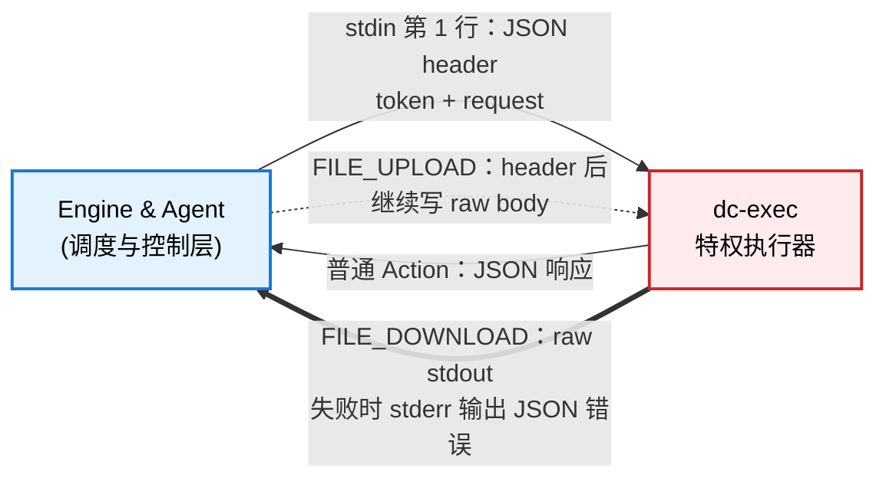

## 概述

dc-exec (`dc-exec`) 是由 Agent 调用的本地特权执行器，负责执行需要提升权限的系统操作。它是整个系统中唯一具备特殊权限的组件，采用严格的安全验证机制确保只有授权的请求才能执行。

### 设计原则

1. **最小权限**: 仅具备必要的权限，降低潜在风险
2. **深度防御**: 多层独立验证，单点失效不影响整体安全
3. **可审计**: 所有操作均有完整审计日志
4. **快速失败**: 尽早拒绝非法请求，减少资源浪费

## 系统架构

### 组件角色

dc-exec 通过**统一的 stdin/stdout 协议**接收所有请求：**stdin 第一行是 `execution.ExecuteInput` 的紧凑 JSON
header，随后可选地跟随 raw body**。普通 Action 返回 JSON；流式 Action 复用同一条管道直接传输文件内容。

### 通信方式

dc-exec 要求 Agent/Engine 在 JSON header 中提供 `token` 与 `request`，并复用同一套协议处理普通/流式 Action。

#### 普通 Action

处理绝大多数轻量级系统操作（如列目录、密码校验、文件检查、任务控制）。

- **输入**: 通过标准输入（stdin）发送一行紧凑 JSON header，并以 `\n` 结束
- **输出**: JSON 格式的响应（通过 stdout 输出）
- **特性**:
    - 请求和响应都经过 JSON 序列化/反序列化
    - 适用于操作量小、响应快的场景
    - 请求完成后立即断开连接

#### 流式 Action

处理大文件传输（上传/下载）。

- **输入/输出**: 使用 stdin/stdout 传输连续的二进制流
- **Header → Body 二段式协议**：
    1. **Header（JSON）**：`{"token":"...","request":{"operation":"FILE_DOWNLOAD","params":{...}},"state":{}}` — 标准起始行，以
       `\n` 结束
    2. **Body（raw binary）**：header 结束后立即开始传输原始字节（不上限，直到 EOF）
- **下载流程（FILE_DOWNLOAD）**：
    - stdin：仅 JSON header，无 body
    - stdout：header 校验和身份验证通过后，立即开始输出文件内容（raw binary）
    - stderr：仅在出错时输出 JSON `{"error":"msg"}`（正常完成时 stderr 无输出）
- **上传流程（FILE_UPLOAD）**：
    - stdin：JSON header 后立即跟随文件内容（raw binary），EOF 表示上传结束
    - stdout：仅在出错时输出 JSON `{"error":"msg"}`
    - stderr：仅在出错时输出 JSON `{"error":"msg"}`

## 执行模式（三维正交架构）

### 权限策略 (`PrivilegeMode`)

- **`PrivilegeRoot`**：显式提权到 root (UID 0)，用于需要修改 `/etc/shadow` 或调用 systemd-run Cgroup 等特权操作。
- **`PrivilegeTargetUser`**：严格降权并切换 UID/GID 到请求指定的普通用户 (UID ≥ 1000)，用于用户文件读写、作业提交、VNC 桌面等。

### 交互模型 (`IOModel`)

- **`IOModelJSON`**：短生命周期标准请求/响应，结果打包为 JSON 返回。
- **`IOModelStreaming`**：大文件双向流式传输（`FILE_UPLOAD` / `FILE_DOWNLOAD`），跳过 JSON 封装。

