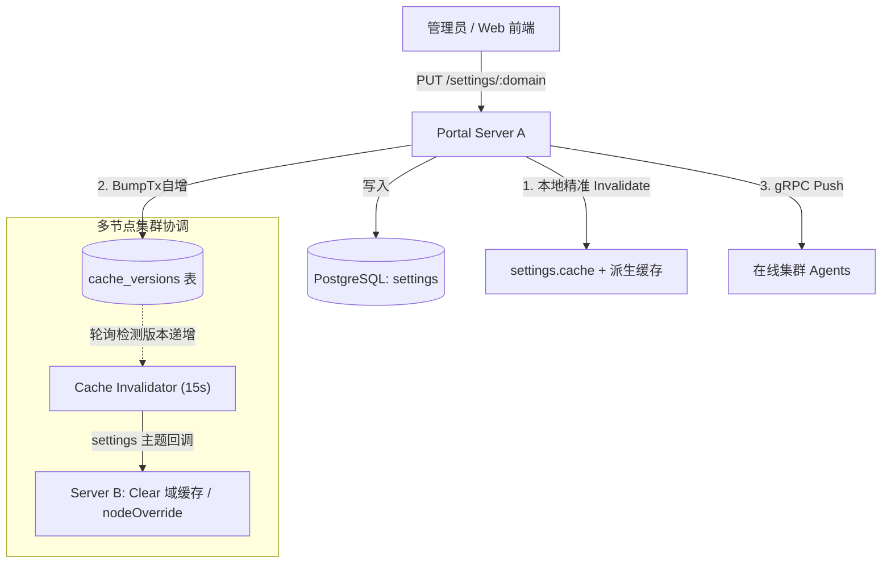

本文档定义设计云平台运行时系统设置（Settings）的架构基线、设计原则与实现规范，供后端维护扩展与客户端对接参考。

---

## 1. 架构定位与设计哲学

设计云平台的配置体系划分为两大正交层次：

1. **静态启动配置 (`config.toml`)**：
   进程冷启动参数（监听地址/端口、数据库连接串、LDAP 绑定凭据等），仅在服务启动时从本地文件读取，不支持热更。
2. **动态系统设置 (`Settings`)**：
   运行期业务配置（认证安全策略、会话 TTL、各子系统缓存时间、告警阈值、dc-exec 路径、VNC 与监控采集参数等）。统一持久化于数据库，支持在线修改、多节点缓存失效与向 Agent 实时推送。

### 核心设计原则

- **单一事实来源 (Single Source of Truth)**：
  后端 Go 结构体（`internal/contract/schema/types.go`）及其结构体标签（`json:"..."`, `validate:"..."`）与同包 `defaults.go` 是配置字段、默认值及校验约束的唯一权威源。
- **零运行时兼容**：
  坚决不引入配置别名、fallback 兜底分支或多版本嗅探。重构即全量对齐，废弃字段直接硬清理；已持久化数据的结构变更使用一次性迁移，不在读写路径保留旧格式兼容。
- **Schema 驱动前端动态表单**：
  后端提供标准 JSON Schema API 暴露字段树与取值约束，前端据此自动生成管理界面与输入限制，杜绝前端硬编码配置模型。

---

## 2. 12 个业务设置域划分

系统设置按**业务语义**收敛为 **12 个正交域**（每个域对应 `settings` 表一条记录、一个缓存键、一个 `/api/admin/system/settings/:domain` 管理端点）：

| 域 (`domain`) | 职责范围与核心字段 | 消费方 |
|---|---|:---:|
| **`platform`** | 平台品牌元信息（名称、描述）、Portal 网站开关（`website.indexEnabled` / `website.overviewEnabled`）、普通用户工作台页面开关（`disabledModules`：模块 ID → 是否隐藏，默认均为 `false`） | Portal / Web |
| **`auth`** | 会话生命周期（`sessionTTL`；`sessionCleanupInterval` **60–86400** 秒，默认 **600**）、每用户活跃 Session 上限（`maxSessionsPerUser`，默认 1，范围 1–5）、防爆破规则（`maxUserLoginAttempts` **5–10** 默认 **5**，`maxIPLoginAttempts` **10–100** 默认 **30**；`userBanDuration` **60–604800** 秒默认 **300**，`ipBanDuration` **60–2592000** 秒默认 **86400**——自动封禁与校验失败回退均取本域默认值，无第二套硬编码）、封禁放行名单（`banAllowlist`，IP/CIDR 列表，默认空；除整域 settings PUT 外，亦支持经 `GET/POST/DELETE /api/admin/security/bans/allowlist` 独立增删查，幂等且热生效）、用户同步间隔、UID/GID 映射缓存 TTL | Portal / User |
| **`connection`** | 连接规格 `maxPerUser` 上限（`maxPerUserCap`，1–16，默认 16）；嵌套 **`proxy`**：协议代理（ProxyConnection）开关与配额（`enabled`、`vncEnabled` / `rdpEnabled` / `sshEnabled`、`maxProxyConnections` 新装默认 200、`0`=不限、`maxProxyConnectionsPerUser`） | Portal / Connection / Proxy |
| **`file`** | 文件管理总开关（`enabled`）、上传/下载控制及配额、审批失效期、单次目录列表窗口（`listMaxEntries`，**50–999**，默认 **999**；实际最多再返回 100 条，上限 **1099**）、自定义额外文件存储位置列表 (`locations[]`) | Portal / File |
| **`overview`** | 监控概览各类资源指标刷新周期（节点状态、算力资源、调度器队列、存储），存储容量采样回溯窗口；`allowUserCluster`（默认 true）控制普通用户是否可访问集群概览 | Web Overview |
| **`storage`** | 全局共享存储集群挂载点配置 (`storages[]`) 及周期探测间隔 (`probeInterval`) | Portal / Storage |
| **`scheduler`** | 调度器类型（`type`：`lsf`/`slurm`/`openlava`，默认 `lsf`，运行中可改，即时切换驱动与 `GET /api/scheduler/meta`）、调度器环境初始化脚本（`envScript`，可选绝对路径，Agent 执行调度器命令前 `source`，支持节点覆盖）、作业列表缓存时间 (`jobCacheTTL`) | Scheduler / Agent |
| **`license`** | 浮动许可证服务监控缓存 TTL（`statusCacheTTL` / `featuresCacheTTL`，**60–900** 秒，默认 **300**）、默认 `lmutil` 工具路径（节点可覆盖；单个许可证服务可再覆盖） | License / Agent |
| **`agent`** | **唯一面向 Agent 运行能力的复合域**：底座工具路径 (`execBinPath`)、VNC 服务启动与扫描参数 (`vnc`)、节点资源监控与额外磁盘挂载监听 (`monitor`) | Agent / dc-exec |
| **`alert`** | 系统资源告警开关、触发百分比与绝对阈值、冷却时间（CPU、系统负载、内存、本机磁盘、共享存储）。负载阈值 `load.maxLoadPercent` 为 load1/CPU 核数×100（**50–200**，默认 **110**）；是否评估由 `load.enabled` 控制 | Monitor / Alert |
| **`desktop`** | 客户端主程序（Velopack）与 sidecar 插件发布总开关、各操作系统使能、主程序保留数量上限、首次安装 Setup 文件名 (`installerFileName`，默认 `DesignCloudDesktop-win-Setup.exe`)，以及桌面产品最低支持版本 (`minSupportedVersion`，空字符串表示不设下限，非空须为 `MAJOR.MINOR.PATCH`；仅在不兼容的 API 或协议变动时提高，普通新增功能只提供可选更新) | Portal / Desktop |
| **`cert`** | 集群节点 TLS 证书自动续期策略（提前续期天数、最大重试次数、退避时间阶梯） | Cert / Cluster |

文档与 API 叙述中的 `platform.website.overviewEnabled` 指 **域** `platform` 下 JSON 字段 `website.overviewEnabled`（`PlatformSettings.Website`，见 `schema/types.go`），不是额外配置层级。

`platform.disabledModules` 管理普通用户工作台页面的全局隐藏策略，键使用稳定模块 ID（`ai`、`app`、`connection`、`file`、`license`、`overview`、`scheduler`、`ticket`），值为 `true` 时登录响应将其列入 `ui.userPortal.modules` 的 deny 列表。客户端偏好中的个人禁用模块继续与该全局设置合并。该配置只控制普通用户界面导航可见性，不替代接口鉴权。`desktop` 域管理桌面客户端与插件发布策略，以及 `minSupportedVersion`（经公开的 `GET /api/version` 的 `data.minDesktopVersion` 投影给客户端自行比较，与同接口中的 Engine 构建信息以及 `GET /api/desktop/releases/latest` 中的最新安装包相互独立；不在业务 API 或 Session 上做服务端版本闸门。该下限仅在不兼容的 API 或协议变动时提高）。

### 2.1 `file.listMaxEntries`（目录/回收站列表窗口）

- **校验与默认**：`50–999`，默认 `999`。无量纲整数，前端原样读写，不做单位换算。
- **实际返回条数**：Portal 把该值作为 `FILE_LIST` / `TRASH_LIST` 的 payload `limit`；dc-exec 在窗口之上最多再读 **100** 个名字并一并 `Lstat` 返回（设置取 `999` 时一次最多 **1099** 条）。读满该上限后目录仍有后续名字时，响应带 `truncated: true`；字段省略表示本次已是完整目录。
- **客户端约定**：以 `truncated` 判断是否截断，不要用 `files.length`。返回集是目录扫描前缀再按文件名排序，不是全目录按字母序的前 N 项。无跨请求 offset 翻页；超大目录应引导精准路径或命令行。

---

## 3. 数据持久化与局部叠加更新

### 3.1 存储模型

数据库模型非常扁平（`internal/model/setting.go`）：
```sql
CREATE TABLE settings (
    domain VARCHAR(64) PRIMARY KEY,
    value  TEXT NOT NULL -- 紧凑 JSON 格式
);
```

### 3.2 局部更新（Patch / Merge）语义

通过 `PUT /api/admin/system/settings/:domain` 更新设置时，采用**安全局部叠加更新**机制：

1. **未携带字段保留现值**：请求体只需携带发生改动的字段（增量 JSON），未携带字段保留现有配置，绝不会被默认值或零值冲掉。
2. **嵌套对象递归叠加**：如更新 `agent` 域下的 `{"vnc": {"scanInterval": 3600}}`，`vnc.binDir` 与 `monitor` 等其他子字段保持原样。
3. **数组整体替换**：数组（如 `storage.storages`、`file.locations`）属于整体策略，更新时以传入的新列表全量覆盖旧列表。
4. **读取侧生效值作为基线**：叠加前先以存量读取值作为基线，存量若残留未知键（如跨版本遗留）会在预处理中剔除。
5. **全量严格校验**：叠加生成的新完整快照，必须 100% 通过 `internal/contract/schema` 的强校验（边界范围、合法枚举、跨字段关联约束）。任一字段不合法则整次操作回滚并返回 `422 Unprocessable Entity`。

---

## 4. 零值语义与持久化约定

`validate` 标签由 `parseValidateTag` 统一解析：写入校验与 `GET .../schema` 共用同一套边界。`allowzero` **仅**用于无独立布尔开关的周期任务哨兵 0（当前仅 `auth.userSyncInterval`）。其他周期、TTL、单一告警阈值一律禁止 0，由独立的 `bool` 开关控制启停。

| 标签模式 | 代表字段 | 传入 `0` 的处理与落库表现 |
|---|---|---|
| **`allowzero`（`min > 0`）** | `userSyncInterval` | **显式 0 原样落库**，表示关闭定时同步功能（仅支持手动触发）。 |
| **`min=0`，无 `allowzero`** | `maxProxyConnections`、告警 `*usedPercent` / `minFreeSpace`（组合条件） | **0 在区间内**，原样落库；业务含义是不限配额（`maxProxyConnections=0`）或关闭该告警子维度。 |
| **无 `allowzero` 且 `min > 0`** | `jobCacheTTL`、`scanInterval`、`metricsInterval`、各类刷新/探测间隔、`statusCacheTTL` / `featuresCacheTTL`、`load.maxLoadPercent`、`cpu.maxUsedPercent`、`uploadMaxSizeBytes` | 显式 0 / 负数在写入时拒绝（`422`），启停由各自的独立布尔开关控制。 |

---

## 5. 节点个性化覆盖与舰队管理

集群中部分节点具备特殊硬件或网络环境（如 GPU 节点、自定义挂载盘、专用 License 工具路径），系统支持节点级个性化覆盖。

### 5.1 覆盖范围限制

为保证集群一致性与拓扑安全，节点覆盖采用**白名单稀疏覆盖**策略，仅允许覆盖 4 个特定子域：
- **`agent`**：允许覆盖 `execBinPath`、`vnc` 启动选项（含 `passwdMode`）、`monitor.nvidiaSmiPath`、`monitor.diskMounts`（本机额外挂载盘）；
- **`alert`**：允许针对单机硬件性能覆盖 CPU、**系统负载（`load.maxLoadPercent`）**、内存、本地磁盘告警阈值（各域仅 `enabled`、`maxUsedPercent`、`maxLoadPercent`、`minFreeSpace`）；
- **`license`**：允许覆盖本机默认 `lmutilPath`（单个许可证服务若配置了自己的 `lmutilPath` 仍优先生效）；
- **`scheduler`**：仅允许覆盖 `envScript`（本机调度器环境脚本路径），`type` 与 `jobCacheTTL` 为集群级，不可覆盖。

> 以下字段属**集群级策略**，不提供节点覆盖：`monitor.metricsEnabled`、`monitor.metricsInterval`（采样粒度需全局一致，否则概览聚合与历史曲线失真）、各告警域的 `cooldownInterval`（通知节奏与节点硬件无关）、`storage` 等全局集群基础设施。

### 5.2 继承与合并（Effective Settings）

- 节点覆盖存储在 `nodes.settings` 字段中（稀疏 JSON）；
- 节点有效配置（`Effective`）：全局配置叠加节点覆盖后的完整融合视图，未覆盖项完全继承全局配置；
- 控制面分发：向 Agent 下发配置或 Agent 本地查询时，始终使用计算出的 `Effective` 配置。

### 5.3 舰队批量更新

通过 `POST /api/admin/system/nodes/settings/batch-update` 支持集群舰队配置按条件统一覆盖：
- 支持按多维度选择器匹配目标节点：`nodeIds`、`groups`（节点组 AND）、`os`、`arch`、`status`（运行状态）；
- 支持批量应用稀疏 Patch（传 `null` 可清除覆盖并恢复继承全局默认）；
- 提供 `dryRun=true` 预演模式，仅返回匹配节点数与变更快照，不实际落库。

---

## 6. 缓存机制与多节点广播热更

系统设置具备较高的读取吞吐要求。与全局域相关的进程内缓存采用 [DB + Bump](./storage-and-cache.md)（`cache_versions` + 本机立即失效）；决策模型与实例清单见[存储与缓存](./storage-and-cache.md)。



1. **单机高性能读取**：`settings.cache`（`TTLCache[schema.Domain, any]`，24h 安全网）日常命中内存；Security 等调用方直接读 Settings，不再叠一层派生 TTL 缓存。
2. **写路径即时失效**：`PUT` 成功后本机 `Invalidate(d)`；并 `BumpTx("settings")`。同一主题还触发 **`nodeOverrideCache.Clear()`**（见[缓存实例清单](./storage-and-cache.md)）。
3. **集群跨节点（DB + Bump 上界）**：
   - 其它 Portal 在 **≤15s** 内（`InvalidatorPollInterval`）通过主题 `settings` 回调对齐；
   - 单节点模式不轮询，仅本机立即失效。
4. **节点行 Settings 覆盖**（`nodeOverrideCache`）：单节点写与 `BumpTx("node_overrides")` 同事务；批量写后一次 `Bump`（失败仅告警仍推送 Agent）。其它 Portal **≤15s** 内 `Clear`。`GetNodeSettings` 的 `effective` 与 `override` 同源 DB 合并，不读缓存。
5. **Agent 在线热更分发**：
   - Settings 写成功后订阅者通知**合并串行**：突发连续 PUT 不会为每次写入各开一条 Agent 推送 goroutine；在途推送结束后若仍有脏标记，再跑一轮（`SettingsPusher.Broadcast` 始终读当前有效配置）。
   - **全局域 PUT** 仅当本次通知涉及会进入 `GetAgentSettingsForNode` / `UpdateSettingsCommand` 载荷的域时，才经 gRPC 向在线 Agent 推送合并后的 `AgentSettings`：`agent`、`storage`、`license`、`scheduler`。其余域（如 `auth`、`desktop`、`platform`、`alert` 等）**不**触发全集群 Agent 推送；`desktop` 等域如需 Portal 端刷新，走独立的 SSE `SubscribeDomains` 路径（与 Agent 推送互补，非替代 `cache_versions`）。
   - **节点覆盖**（`PUT /api/admin/system/nodes/:id/settings` 或批量接口）仍对该节点调用 `PushNodeSettingsUpdate`，与上述全局域过滤无关。

---

## 7. Schema 驱动的前端动态渲染与预校验

前端界面（Web 门户或桌面管理控制台）**无需为每个配置字段手动硬编码 UI 结构与校验规则**，完全通过后端的 Schema 体系实现自动化渲染：

### 7.1 Schema API 清单

| 端点 | 方法 | 鉴权要求 | 说明 |
|---|:---:|---|---|
| `/api/admin/system/settings/domains` | `GET` | System Admin (`ScopeSettings`) | 获取当前系统支持的 12 个设置域列表 |
| `/api/admin/system/settings/:domain/schema` | `GET` | System Admin (`ScopeSettings`) | 获取指定域的标准 JSON Schema 结构定义 |
| `/api/admin/system/nodes/:id/settings/schema` | `GET` | System Admin (`ScopeNodes`) | 获取指定节点的覆盖配置 JSON Schema 定义 |

### 7.2 Schema 元数据能力

后端通过反射解析 Go struct 标签，动态生成标准的 JSON Schema 输出：

```json
{
  "type": "object",
  "properties": {
    "scanInterval": {
      "type": "number",
      "default": 60,
      "minimum": 30,
      "maximum": 86400,
      "allowZero": true,
      "unit": "s"
    },
    "minFreeSpace": {
      "type": "number",
      "default": 0,
      "minimum": 0,
      "allowZero": true,
      "unit": "KiB"
    },
    "nvidiaSmiPath": {
      "type": "string",
      "default": ""
    }
  }
}
```

- **类型展开**：递归展开 `object`、`array` 与基础标量类型；
- **默认值与水印**：输出各字段在代码层定义的权威 `default` 值，供前端控件展示占位符与初始值；
- **边界约束与枚举**：直接在 Schema 属性中下发 `minimum`、`maximum`、`enum` 与 `allowZero`；后端保存时按同一 `validate` 标签校验（含结构体切片元素），字符串枚举为空值时只有带 `omitempty` 才放行，可选值只在标签中声明一次；
- **物理量基准单位（`unit`）**：严格遵循国际标准物理计量符号体系（SI / IEC 80000-13 / IEEE / UCUM），输出封闭且无歧义的机器标识符：
  * 时间量纲：`s`（基准秒）、`h`（小时）、`d`（天）；
  * 容量量纲：`B`（基准字节，文件传输）、`KiB`（千字节，系统监控 1024 字节）；
  * 无量纲标量：条目数、重试次数、并发连接数等纯数字不标注 `unit`；
- **敏感字段保护**：密码或凭据类字段不会在 Schema 或 GET 中明文回传。

### 7.3 前端工作流最佳实践

```
1. 导航构建：
   调用 GET /settings/domains 获取 12 域清单，动态渲染左侧管理菜单。

2. 页面载入：
   用户切换至某域时，并发调用：
     - GET /settings/:domain/schema （获取结构定义与约束）
     - GET /settings/:domain        （获取当前实际值）

3. 表单渲染与即时校验：
   - 依据 schema.properties 的结构递归生成表单控件；
   - 依据 schema 中的 minimum / maximum 限制数值输入范围；
   - 依据 schema 中的 enum 渲染下拉框选项；
   - 依据 schema 中的 default 展示缺省值或 Watermark 占位符；
   - 依据 schema 中的 unit 为数值控件注入物理单位，结合前端 `humanize(val, unit)` 进行动态展示与计算：
     * 时间（unit="s"）：底层存储与校验以秒（s）为基准，前端可在输入框旁动态换算可读展示（如 3600 -> "1 小时"，86400 -> "1 天"），或提供 "秒/分/时/天" 快捷换算切换器；
     * 容量（unit="B" / unit="KiB"）：按对应基准单位动态计算为 KiB / MiB / GiB 展示；
     * 纯数字交互：前端在保存变更时，统一换算回 Schema 声明的基准数值提交，避免前后端换算误差。

4. 变更提交：
   - 监听表单改动，仅序列化用户实际发生变更的字段（增量 JSON）；
   - 发送 PUT /settings/:domain；
   - 响应 204 说明保存成功，重新拉取当前值刷新展示；
   - 响应 422 解析后端返回的结构化错误提示，展示在相应字段旁。
```

### 7.4 带物理单位数值控件的交互与换算设计范式

为了防止管理员在配置较长时间跨度或较大容量参数时（如配置 7 天或 10GB）手动换算产生数量级失误，前端界面应依据 Schema 中声明的 `unit` 属性，采用如下与具体技术栈解耦的交互设计范式：

#### 1. 交互形态与线框图

##### 形态一：双向联动输入模式（Dual-Linked Mode）
适合需要直观呈现底层原生数值、同时允许高阶语义输入的管理场景：

```text
+---------------------------------------------------------------+
| 字段名称:                                                     |
| [  86400  ] s   <==== 双向联动 ====>  [   1   ] [  d  ▾ ]     |
| (基准物理输入框)                      (语义换算输入与单位选择) |
+---------------------------------------------------------------+
```
- **双向数据同步原则**：
  - 用户修改基准输入框的值 $V_{base}$ 时，语义输入框自动基于当前选中单位的换算倍率 $M$ 计算并更新显示值：$V_{display} = V_{base} / M$；
  - 用户修改语义输入框的值 $V_{display}$ 或切换下拉单位时，基准输入框自动根据倍率重新计算：$V_{base} = V_{display} \times M$；
  - 最终表单提交 Payload 严格只采集基准输入框中的整数 $V_{base}$。

##### 形态二：复合单位输入控件（Compound Unit Mode）
主流紧凑型设计，单个输入框紧贴单位选择下拉框，底部辅以水印换算说明：

```text
+---------------------------------------------------------------+
| 持续告警重推间隔:                                             |
| [      12      ] [  h  ▾ ]                                    |
| ↳ 当前基准值: 43,200 s  (有效约束: 60s ~ 86,400s)              |
+---------------------------------------------------------------+
```
- **数据绑定与守恒原则**：
  - 用户在输入框中填入 $V_{display}$，选择单位倍率 $M$；
  - 界面内部维护基准物理值 $V_{base} = V_{display} \times M$；
  - 切换下拉框单位时，保持 $V_{base}$ 不变，自动重新计算显示值 $V_{display}$（例如将 `12 h` 切换为 `d` 时，显示值自动更新为 `0.5`）；
  - 实时校验：根据当前选中的单位倍率 $M$，动态缩放 Schema 下发的 `minimum` 与 `maximum` 提示范围。

#### 2. 通用量纲家族与倍率矩阵

前端可将具有相同物理量纲的单位抽象为转换矩阵（基准单位倍率固定为 1）：

| 量纲家族 | Schema 声明 (`unit`) | 可选单位与换算倍率 ($M$) |
|---|---|---|
| **时间体系** | `s` | 秒 (`s`, $\times 1$)、分钟 (`min`, $\times 60$)、小时 (`h`, $\times 3600$)、天 (`d`, $\times 86400$) |
| **文件容量体系** | `B` | Byte (`B`, $\times 1$)、KiB ($\times 1024$)、MiB ($\times 1024^2$)、GiB ($\times 1024^3$) |
| **监控告警容量** | `KiB` | KiB ($\times 1$)、MiB ($\times 1024$)、GiB ($\times 1024^2$) |
| **固有时间周期** | `d` / `h` | 仅展示固定天/小时后缀，不进行多级换算 |

#### 3. 边界与整除处理准则

- **无量纲纯数（原样直通，零转换操作）**：文件条目数上限（如 `trashMaxItemCount`、`listMaxEntries`）、并发连接数、重试次数等纯计数字段属于无量纲标量，不声明 `unit` 属性。前端遇到无 `unit` 的数值属性直接使用标准数字输入框，**不执行任何倍率乘除、单位解析或换算操作（原样直通）**，无需单位下拉框或联动计算，输入即所得、所填即所存，保持界面与逻辑绝对纯净无噪音；
- **数组字段元素语义**：对于原始类型切片（如 `backoffScheduleHours []int`），字段上的 `validate:"min=…,max=…"` 与 `unit` 都作用在**每个元素**上；Schema 把 `minimum`/`maximum` 放在 `items` 上，`unit` 仍在数组字段上。前端应对每个元素分别做单位换算与范围提示；
- **UI 展示文案灵活性**：Schema 中的 `unit` 为严谨的机器标识符（如 `KiB`、`s`）。在前端界面呈现时，UI 下拉框文案可根据用户习惯自由显示（例如 `KiB` 在前端界面展示为 `KB` 或 `KiB` 均可），只要换算倍率严格遵守 1024 二进制即可；
- **整型对齐**：由于大部分基准字段（如超时秒数、字节数）在后端为整型（`int`/`int64`），当用户输入的浮点语义值经倍率相乘后产生小数（如在秒基准下输入 `0.001 分钟` 得到 `0.06 秒`）时，界面应即时提示取整或自动四舍五入；
- **零值语义（`allowZero`）**：当 Schema 中 `allowZero=true` 且用户输入 `0` 时，无论单位切换为何种选项，基准值一律直接归零并绕过 `minimum` 校验；
- **解耦独立性**：整个换算与展示逻辑完全由前端动态驱动，后端无需变更任何通信协议或存储结构。
