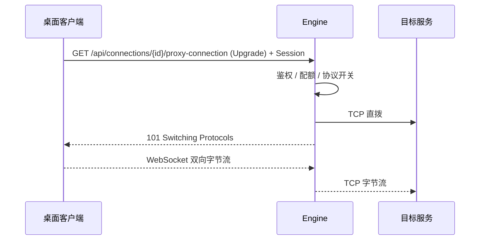

> 协议细节和 API 示例见本文档下文，两种接入方式的概念对比见 [连接生命周期模型](./connection.md)。

Design Cloud Engine 的协议代理面向**桌面 Portal 客户端**：在客户端与计算节点上的 VNC / RDP / SSH 等服务之间建立**透明字节隧道**。Engine **不解析**应用层协议，**不经 Agent 转发**桌面载荷；数据面为 **客户端 WSS ↔ Engine ↔ 目标 TCP `host:port` 直拨**。

- `ProxyConnection` 是运行时会话，只存在于**接受 WebSocket 握手的 Engine 节点**内存中
- 数据面使用 **Portal 登录 Session**（`Authorization: Bearer`），不再签发代理 OTP
- 链路异常或节点故障后，客户端重新发起同一次 WebSocket 握手即可

> TurboVNC 直连 Viewer 使用的协议层 OTP 仍由 `POST /api/connections/:id/vnc-otp` 在目标节点生成，与协议代理无关。

## 数据面路径与信任边界

| 段 | 传输 | 说明 |
|---|---|---|
| 客户端 → Engine | **WSS**（与 Portal 同端口） | 隧道载荷在 TLS 内；Session 通过握手头 `Authorization: Bearer` 传递，**不得**放在 URL query |
| Engine → 目标节点 | **明文 TCP** | Engine 只做字节转发 |

## 会话模型（一次握手：一条 WSS + 一条 TCP）

- **VNC / RDP / XRDP**：对已有 `connectionId` 发起 `GET /api/connections/{id}/proxy-connection` + `Upgrade: websocket`，携带 Portal Session。
- **SSH**：对可访问的 SSH **规格**发起 `GET /api/connections/ssh?resourceId={id}` + `Upgrade`；Engine 当场选机并拨号，**不写** `connections` 行。断线即结束。SSH **没有** connection Start/Stop；关 WSS 即拆隧道。并发只受下方本机 `maxProxyConnections*`。**故意不**按规格 `maxPerUser` 拒绝第二条隧道：单节点计数在多 Engine / 不同选机结果下语义不成立；同锚点再 Upgrade 仅**顶替**本机会话。跨节点「是否已有隧道」也不做集群级检查。
- 接到请求的 Engine 校验权限与配额、拨目标 TCP、回 `101` 并桥接。
- 同一锚点（connectionId 或 resourceId）在同一节点上再次 Upgrade 时，**替换本机**已有隧道；多节点负载均衡下，不同节点可能各持一条隧道，直到各自断开。
- **桌面客户端不得以轮询无 Upgrade 的 GET 判断隧道是否存活**（多节点下该查询只反映本机，会误报 404）。以 WebSocket 物理断开（EOF / CloseFrame）为唯一事实来源。

## 配置

| 设置项 | 说明 |
|---|---|
| `connection.proxy.enabled` | 是否启用协议代理 |
| `connection.proxy.maxProxyConnections` | 本节点全局最大 **active** 隧道数；`0` 不限；新装默认 `200` |
| `connection.proxy.maxProxyConnectionsPerUser` | 本节点单用户最大 active 隧道数 |
| `connection.proxy.vncEnabled` / `rdpEnabled` / `sshEnabled` | 协议开关 |

## 流程



## API

**建立隧道（WebSocket）**

```http
GET /api/connections/{id}/proxy-connection
Upgrade: websocket
Authorization: Bearer <portal-session>
```

**查询本机活跃会话**（非存活探测；VNC/RDP/XRDP）

```http
GET /api/connections/{id}/proxy-connection
Authorization: Bearer <portal-session>
```

关闭隧道：桌面关闭 WebSocket 即可；**不提供** `DELETE` 拆隧道接口。

常见错误：

- `403`：无权访问 connection、协议未启用、Origin 校验失败（Upgrade 前）
- `429`：本节点配额已满
- `502`：拨号失败（不留下会话）
- `404`：无 Upgrade 的 `GET` 时本机无该用户的 active 隧道

## 桌面客户端集成契约

本文面向 **Engine 仓库外的桌面 Portal 客户端**（Wails / 原生壳等）。HTTP 字段与状态码以 [用户 API · Connection Proxy](/docs/api/user.md#connection-proxy) 与 [Files](/docs/api/user.md#files) 为准；此处只写**必须遵守**的运行时行为，避免多节点部署下出现隐性兼容假设。

### 协议代理

| 必须 | 说明 |
|------|------|
| 一次 Upgrade | 对 `GET /api/connections/{id}/proxy-connection` 携带 `Upgrade: websocket` 与 `Authorization: Bearer <portal-session>` 建隧。不再使用两步 OTP 或 `GET /api/proxy-connection`。 |
| Session 仅放 Header | 不得把 Portal Session 或任何凭证放进 URL query。 |
| Origin（生产） | 若 Engine 配置了 `portal.websocket_host`：Wails 客户端通常发 `wails://…`（允许）；纯原生库若不带 `Origin` 会被 **403**。勿伪造任意浏览器 Origin；需走 Wails/`localhost` Origin，或运维侧确认 `websocket_host` 留空（仅内网无 DNS rebinding 风险时）。 |
| 存活判定 | 以 WebSocket 物理断开（EOF、CloseFrame、本地读写错误）为隧道结束的唯一事实来源。 |
| 禁止轮询探活 | **不得**定时调用无 `Upgrade` 的 `GET .../proxy-connection` 判断桌面是否在线。该查询只反映**当前 Engine 节点**上的 active 隧道，负载均衡下会频繁 `404`。 |
| 断流重连 | 节点故障或网络中断后，重新发起同一次 Upgrade；不假设隧道可跨节点迁移。 |
| 与 VNC OTP 区分 | TurboVNC 直连仍用 `POST .../vnc-otp`（目标节点协议层密码），与协议代理无关。 |

实现要点：

1. 对 Portal origin 发起 WebSocket：`GET /api/connections/{connectionId}/proxy-connection` + `Upgrade`，`Authorization: Bearer <portal-session>`
2. 本地 `127.0.0.1` 起 TCP 监听，与 WebSocket 双向拷贝；原生客户端连 loopback
3. WebSocket 单帧读上限 **4 MiB**

### 文件下载

| 必须 | 说明 |
|------|------|
| 流式落盘 | `POST /api/files/downloads` 与 `POST /api/files/download-requests/{id}/content` 的响应体为二进制流。客户端必须用 **流式响应**（pipe 到本地文件），不得将整包读入内存缓冲区。 |
| 鉴权 | 直接下载与审批后下载均凭 Portal Session；路径与审批状态由服务端当场校验（无独立下载 token）。 |
| 断流重试 | 传输中断后重新发起同一条 POST；不假设字节流可挂接到另一台 Engine。 |

上传仍为一次 `PUT .../locations/.../contents/*` 流式请求，规则不变。

### 发布前自测清单

1. Proxy：仅 Upgrade + Session 可打通 VNC/RDP/SSH；拔掉网络后 UI 以 WS 状态为准恢复或提示重连，无后台轮询 `GET .../proxy-connection`。
2. 下载：对大于可用内存的测试文件，`POST /api/files/downloads` 内存占用保持稳定（流式写盘）。
3. 双 Engine + least_conn：隧道与下载在任一存活节点上均可完成，无「先换票再消费」步骤。

## 集群与重连

- 新隧道与新的下载 POST 由七层 **最少连接**（`least_conn`）选择 Engine；不为代理或下载配置「粘回签发节点」的上游规则。
- 长连接计入活跃连接数；新 Upgrade 与新的下载 POST 会落到相对更空的节点。
- 隧道只存在于接受握手的节点；无 Upgrade 的 `GET` 打到其他节点为 `404`。
- 断代理不结束节点上的桌面进程；断流后重新 Upgrade。关闭隧道靠桌面关 WebSocket，无 `DELETE` proxy 路由。

## 可选：半关闭控制帧

数据面可发送 Text JSON `{"op":"close-write"}`，Engine 对后端 TCP 执行 `CloseWrite()`。
