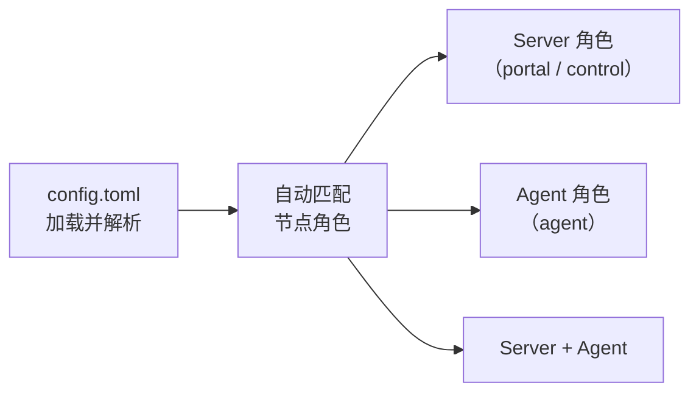
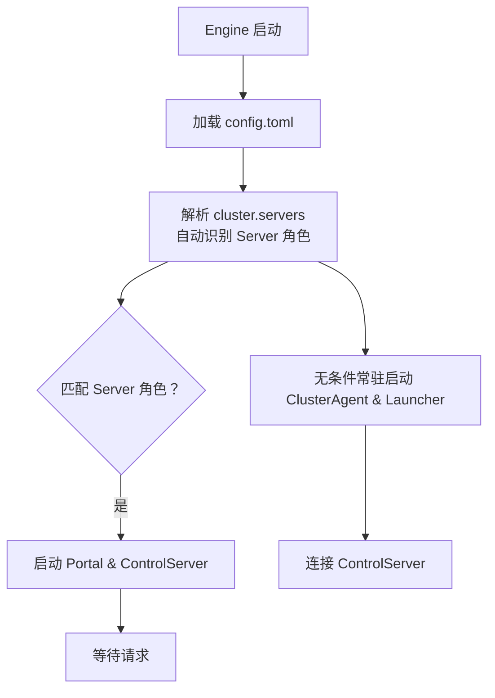
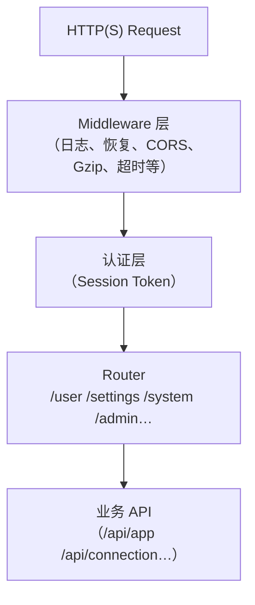
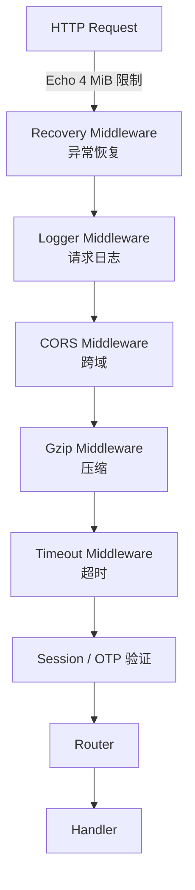
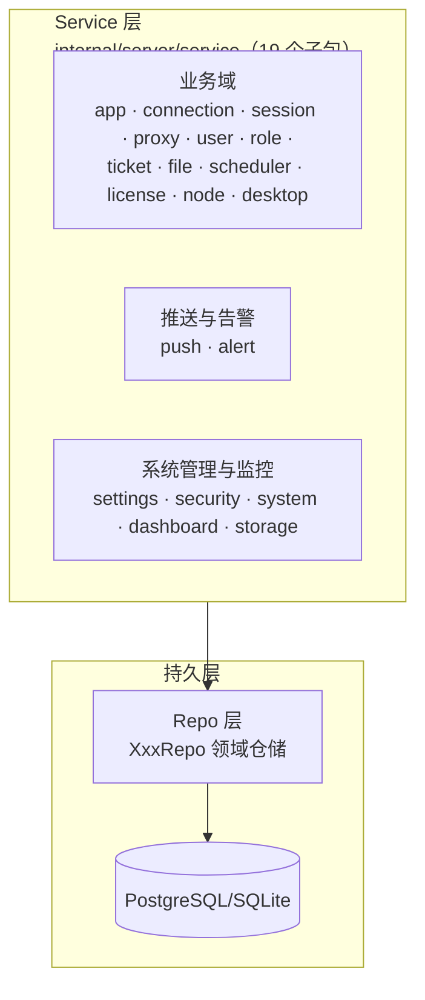

> 补充说明：本文档对源码结构、层次职责与协作关系进行说明。

## 项目概述

Design Cloud Engine（DCE）是由 Go 语言编写的 HPC 桌面管理引擎。它提供了从资源调度、会话管理、文件传输到 VNC 远程桌面的完整
SaaS 工具链。

## 核心流程

```mermaid
flowchart TD
    Portal["Portal (HTTP/WS)\n用户交互入口"]
    ControlServer["ControlServer (gRPC)\n节点编排与状态管理"]
    PortalDomainService["Portal 业务层\napp/connection/proxy/session/..."]
    AdminAPI["Admin API\n(/api/admin/system /api/admin/security /api/admin/audit)"]

    Portal --> PortalDomainService
    Portal --> AdminAPI
    PortalDomainService --> ControlServer
    PortalDomainService --> DB[("PostgreSQL/SQLite")]
    AdminAPI --> DB

    subgraph DashboardAgent["内部数据层"]
        AggregationService[("聚合服务")]
    end

    ControlServer --> DashboardAgent

    subgraph AgentNode["Agent 节点"]
        ClusterAgentNode["ClusterAgent\n(gRPC client)"]
        ClusterAgentNode --> AgentExecutor[("Executor\n(任务执行)"]
        ClusterAgentNode --> Launcher["Launcher\n(特权桥接)"]
    end

    %% 详细的 Agent 内部控制流与子组件协作，请参考 docs-site/docs/development/cluster/agent-architecture.md

    ControlServer <-- gRPC --> ClusterAgentNode
    ControlServer --> AgentExecutor
    ControlServer --> Launcher

    Launcher --> ClusterAgentNode
    Launcher --> AgentExecutor
```

> 说明：
>
> - `Portal` 旁边的 `Aggregation Service` 对应 `internal/server/service/dashboard` —— 它定期拉取当前节点的聚合数据，供
    Portal
    展示系统看板。
> - `ClusterAgent` 旁边的 `ResourceReport Collection` 对应 agent 侧的资源状态采集与 `ResourceReport` 上报循环。
> - `Launcher` 与 `Agent` 之间的交互走 Unix Domain Socket，见 `docs-site/docs/development/launcher/`。

## 启动流程





> 说明：
>
> - Server 角色通过 `cluster.servers` 列表与 hostname 模式匹配。
> - Agent 角色全节点无条件常驻启用。

## 节点角色

节点角色由 `Cluster.Servers` 列表与本机 hostname 自动匹配，不通过命令行 mode 指定。

| 角色     | 判定条件                                                      | 承载能力                                                           |
|--------|-----------------------------------------------------------|----------------------------------------------------------------|
| Server | hostname 匹配 `cluster.servers` 中的任意项                   | Portal、Control、数据库驱动的业务服务                                      |
| Agent  | 全节点常驻无条件启用                                         | ClusterAgent、resource_report collection、Executor 和 Launcher 协作 |

一个节点可以同时具备两种角色，这意味着：

- 单机开发或小规模部署时，同一进程可以同时启动 Server 与 Agent。
- 分布式部署时，管理节点通常承担 Server 角色，计算节点通常承担 Agent 角色。

## 角色能力矩阵

| 能力                                | Server | Agent | 说明                        |
|-----------------------------------|--------|-------|---------------------------|
| Portal (HTTP/WS)                  | ✓      |       | 用户交互入口，CLI 工具/Web UI      |
| Admin API (system/security/audit) | ✓      |       | 三员管理接口                    |
| Control (gRPC Server)             | ✓      |       | 与 Agent 节点的 gRPC 通信       |
| ClusterAgent (gRPC Client)        |        | ✓     | 连接 ControlServer 并接受指令    |
| Executor                          |        | ✓     | 执行 Scheduler 任务与 Proxy 会话 |
| Launcher                          |        | ✓     | 特权桥接，守护进程                 |
| 资源状态采集上报 (ResourceReport)   |        | ✓     | 节点 CPU/内存/磁盘等资源数据定时上报 |
| DB 业务服务（模型、服务层）                   | ✓      | ✓     | 共享代码层面的公共模块               |

> 说明：当 Server 与 Agent 在同一进程运行时，Executor/Launcher 的职责由 Agent 运行时接管。

## 分层架构

### Portal 层

Portal 是一个标准的 Echo v5 HTTP 框架端点层，所有请求会经过 **Middleware → Portal Router → 认证 → 业务 API** 路径流转：



> 说明：Admin API 位于 `/api/admin/system`、`/api/admin/security`、`/api/admin/audit` 路径下，路径一致则命名一致。

#### Frontend → Portal Middleware → Auth → Router → API 请求链



### 业务层 (Service Layer)

业务逻辑位于 `internal/server/service/` 下的 19 个子包，由 `service.go` 中的 `Container` 统一聚合：



> 说明：service 通过 `internal/db` 的领域仓储（`XxxRepo`）读写数据库；`db.Store` 仅承担建连、迁移、关闭与缓存版本管理等基础设施职责，不承载业务方法。

各子包职责速览：

| 子包         | 职责                                                                 |
|--------------|----------------------------------------------------------------------|
| `alert`      | 集中式告警状态机：按「指标 × 目标」判定触发/持续/恢复，经 push.Hub 推送并落告警历史 |
| `app`        | 远程应用管理：注册、用户关联与启动并发限制                             |
| `connection` | 连接领域读写，并触发节点侧连接信息采集（VNC 等）                       |
| `dashboard`  | 聚合看板：节点状态、资源、调度器、存储数据的 TTL 缓存聚合               |
| `desktop`    | 桌面客户端发布资产管理：manifest 拉取、资产清单与缓存                   |
| `file`       | 文件管理：经 execution 派发到 Agent 执行删除等文件操作                 |
| `license`    | FlexLM 许可证服务管理与状态按需探测（只读查询，经 execution 执行，双 TTLCache 节流） |
| `node`       | 节点接入：CA 与节点 gRPC 证书的生成签发                                |
| `proxy`      | VNC 代理连接与代理隧道生命周期管理                                     |
| `push`       | SSE 推送基础设施：Hub 按用户 ID / 角色路由事件给在线客户端              |
| `role`       | 角色成员管理与角色约束校验                                             |
| `scheduler`  | 对接外部调度器（LSF 等）：作业状态归一化与作业控制                     |
| `security`   | 认证失败跟踪、IP/用户封禁与授权边界执行                                 |
| `session`    | 会话生命周期：登录认证、签发、续期、失效与过期清理                      |
| `settings`   | 平台运行时设置：domain 键值配置读写与 Schema 管理                       |
| `storage`    | 共享存储监控数据查询统计，支持触发信息采集                              |
| `system`     | 系统健康与运行信息的聚合快照                                            |
| `ticket`     | 工单系统：工单与工单项目的管理、统计与推送通知                          |
| `user`       | 用户账号管理：scope 权限位、密码策略与管理员账号同步                    |

### gRPC 层

集群内部的 Control ↔ Agent 节点间通信全量走 gRPC，接口定义位于 `internal/contract/proto/cluster.proto`。

### 基础支撑包

分层架构之外还有三个横向支撑包：

- `internal/common`：进程内通用工具库——有界缓冲、错误约定、安全执行辅助等通用能力（含 `crypto` / `format` / `fs` / `host` 子包），不含业务语义。
- `internal/audit`：审计日志服务：主审计日志与安全日志双通道落盘（携带 node ID 与版本号），供 Admin API 的 audit 接口查询。
- `internal/logger`：slog 日志初始化与轮转封装（基于 timberjack 的旋转配置，dev / prod 两套输出策略）。

### 数据对象层

项目按职责划分了三类数据对象，避免混淆：

| 包                           | 用途          | 特征                                                                                                                       |
|-----------------------------|-------------|--------------------------------------------------------------------------------------------------------------------------|
| `internal/model`            | DB 持久化模型    | GORM tag；表名遵循 GORM 默认复数化约定映射到数据库表（未使用自定义 `TableName()`）                                        |
| `internal/contract`         | 跨层中立契约与 DTO | 无持久化 tag，跨 agent/control/service 等多层共享（如 `ConnectionInfo`、`CollectTrigger`、`AgentSettingsProvider`；子包 `proto` 存放 gRPC 协议，配置 Schema 位于 `internal/server/service/settings/schema/`） |
| `internal/server/service/*` | 业务与 API DTO | 绑定业务逻辑与 HTTP 协议边界，面向服务逻辑与 handler 序列化                                                                                    |

`internal/contract` 与 `internal/model` 分离的原则：运行时契约/payload 不应依赖 GORM 或数据库表结构，避免将传输与中立解耦关注点泄漏到持久化模型中。

> 依赖方向说明：`internal/model` 会导入 `internal/contract`（共享枚举/DTO，见 `internal/model/connection.go`）；而 `internal/contract` 严格保持中立，不得反向依赖 `internal/model` 或 `internal/db`。

## 缓存机制

为保证平台的高吞吐与集群一致性，DCE 在 Service 层建立了基于访问特征精准缓存的机制：

- **读多写少的高频静态数据**（如 `settings` 动态配置、`session` 鉴权 Token、`security` IP 封禁拦截）采用**进程内内存快照与双索引结构**，并通过共享数据库的 `cache_versions` 版本号轮询实现多节点秒级近实时失效广播；
- **昂贵系统命令与远程调用**（如 `scheduler` 作业查询 `bjobs`/`squeue`、`desktop` 客户端发布清单、`license` 许可证按需探测）采用**泛型带锁 `TTLCache`** 进行节流与防击穿保护（`license` 模块使用独立 `license` 域双 `TTLCache` 进行状态与 Feature 隔离）；
- **强时效性与复杂组合业务**（如 `connection` 远程桌面运行态、`file` 文件系统、`ticket` 工单过滤）**严禁或无需缓存**，以单条索引 SQL 直查保证绝对强一致性。

> 详细的缓存四要素决策模型、全系统对照矩阵与失效广播机制，请参考专项设计文档：[缓存架构与决策模型](/docs/development/cache)。

