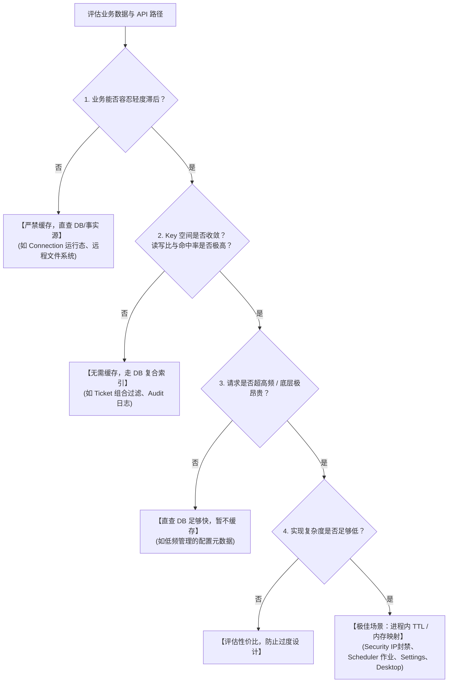

Design Cloud Engine 坚持**“基于访问特征精准缓存，拒绝盲目加 Cache”**的设计哲学。

---

## 1. 缓存考量四要素 (Core Decision Pillars)

在评估是否为某一业务数据或 API 引入缓存时，必须综合考量以下四个正交维度：

1. **时效性容忍度（弱一致性接受度）**：
   业务能否容忍秒级至分钟级的数据轻度滞后？
   - *高容忍场景*：IP 封禁黑名单、HPC 调度器作业列表、发布清单、动态系统设置。即使多节点有数秒不同步，也不破坏系统整体防御或业务流转。
   - *零容忍场景*：远程桌面连接运行态（`connection`）。一旦缓存延迟导致状态失真，Guacamole 代理会直接报 502 或连接失败。
2. **缓存命中率与访问局部性（读写比与 Key 空间收敛度）**：
   该数据是否具有极高的**读写比（读远大于写）**？查询 Key 是否收敛？
   - *高命中率场景（> 90%）*：全局 Settings、单一 IP 拦截判断、按用户聚合的应用列表。Key 空间小且高度集中，缓存收益巨大。
   - *低命中率反模式（Anti-Pattern）*：如工单多维过滤（`TicketFilter` 包含状态、创建人、时间段、关键字、多字段排序等十几种参数组合），Key 空间近乎无限离散，缓存命中率趋近于 0，引入缓存只会浪费内存并增加失效维护负担。
3. **单次访问开销（计算负载与 I/O 放大）**：
   直查底层事实源的代价是否极其昂贵？
   - *网关鉴权与安全拦截*：每个 HTTP 请求的必经之路，直查 DB 会迅速打满数据库连接池造成放大攻击，必须内存高速判定。
   - *外部 CLI / 网络阻塞调用*：如 `bjobs` / `squeue` / `lmstat`，频繁 Fork 子进程会耗尽宿主机资源，必须前置加锁与 TTL 节流。
4. **实现与失效复杂度（KISS 原则）**：
   优先采用**进程内带 TTL 的泛型内存缓存（`cache.TTLCache`）**，避免引入外部分布式缓存中间件（如 Redis）带来的网络开销、故障面增加与双写一致性死锁。



---

## 2. 全系统服务缓存决策对照矩阵

| 服务模块 | 缓存现状 | 推荐策略 | 决策依据与架构考量 |
|---|---|:---:|---|
| **`security` 安全拦截** | **已内置** 黑名单 `BanCache` + `authSettingsCache` | **极佳 ⭐⭐⭐⭐⭐** | 每次 HTTP 请求必经。内存判定防御放大攻击，多节点秒级弱一致完全满足防御需求。 |
| **`scheduler` 作业管理** | **已内置** `TTLCache`（`jobCache`） | **极佳 ⭐⭐⭐⭐⭐** | `bjobs`/`squeue` 是外部 HPC 调度器 CLI。列表缓存阻断前端轮询带来的进程 Fork 风暴；写操作即时 `Clear()`。 |
| **`settings` 动态配置** | **已内置** `TTLCache`（按域快照） | **极佳 ⭐⭐⭐⭐⭐** | 全局高频读取，写极少。内存无锁直读避免数据库被打崩。 |
| **`dashboard` 态势聚合** | **已内置** `cache.Cell` ×4（节点状态/资源/调度/存储） | **高 ⭐⭐⭐⭐** | 聚合读模型：单块数据 + 采样时间戳，过期先返回旧值、后台刷新，允许延迟。 |
| **`user` UID/GID 映射** | **已内置** `TTLCache` ×2（用户/组，正/负/降级 TTL） | **极佳 ⭐⭐⭐⭐⭐** | 文件属主展示高频读、身份源查询昂贵；按 ID 精准失效 + 管理员 refresh 广播。详见 [用户体系 · UID/GID 名字映射](user-system.md)。 |
| **`desktop` 资产分发** | **已内置** `TTLCache`（`desktop.cache`） | **极佳 ⭐⭐⭐⭐⭐** | 跨公网远程请求，数据变动极低，长周期缓存收益最大。 |
| **`license` 许可证监控** | **已内置** 双 `TTLCache`（`statusCache` / `featuresCache`） | **极佳 ⭐⭐⭐⭐⭐** | `lmutil lmstat` 是重量级网络阻塞命令，防雪崩与 singleflight 保护必不可少；运行态只读缓存，严禁回写 DB。 |
| **`session` 会话鉴权** | **已内置** `sessionInfoCache`（Token→会话双索引） | **高 ⭐⭐⭐⭐** | 减轻鉴权中间件对 DB 的高频查询压力。 |
| **`connection` 列表** | **已内置** `TTLCache`（`connListCache`，仅按用户列表） | **高 ⭐⭐⭐⭐** | 仅缓存**按用户的连接列表**查询，写入路径即时失效；连接**运行态**仍以 DB/探针为唯一事实源，禁止缓存运行态。 |
| **`app` 应用模版** | **无缓存 (单条 SQL 优化)** | **中等 ⭐⭐⭐ (可选)** | 数据量小（数十至数百），单条带索引 SQL 耗时 < 0.5ms，直查确保管理员更新即时生效。 |
| **`file` 远程文件系统** | **无缓存** | **低 ❌ (不适合缓存)** | 文件树与目录内容随用户操作实时变化（新建、上传、解压），必须强实时，缓存会导致文件视图不一致。 |
| **`ticket` 工单系统** | **无缓存** | **低 ❌ (无必要)** | 典型 CRUD 表，复杂组合过滤与动态分页，缓存命中率极低，走 DB 索引性能最优。 |
| **`audit` 审计日志** | **无缓存 (异步落盘)** | **零 ❌ (不适合缓存)** | 写多读少的数据流，读操作由审计员专用过滤查询，走 DB 索引即可。 |

> 本表只回答「要不要给这个模块上缓存」。具体缓存的**原语、TTL 来源与默认值、失效方式**统一维护在
> [缓存实例清单](#缓存实例清单唯一事实源)，不在本表重复（历史上的多处枚举已多次出现不同步）。

---

## 3. 缓存清单与协调机制

本节回答两个问题：**全系统有哪些缓存、各自的 TTL 与失效方式是什么**（见下方
[缓存实例清单](#缓存实例清单唯一事实源)，唯一事实源），以及**需要跨节点保持近实时一致性的
缓存如何协调**——对 `settings`、`session`、`ban`、`id_mappings` 这类，系统采用基于
**DB 版本号轮询（CacheVersion Invalidator）** 的轻量协调机制，无需引入外部消息队列。

### 架构与组件

```text
┌──────────────┐    ┌──────────────────┐    ┌──────────────┐
│ Portal API   │    │  settings.Service │    │  各业务读取者  │
│ UpdateSettings│───▶│  UpdateByDomain() │───▶│  GetXxxSettings│
└──────────────┘    └──────────────────┘    └──────────────┘
                            │                       ▲
                            ▼                       │
                     ┌──────────────┐        ┌──────────────┐
                     │  TTLCache    │────────│  24h TTL      │
                     │  (per domain) │  miss  │  (read-through)│
                     └──────────────┘        └──────────────┘
                            │
                            │ Invalidate(d) + BumpTx("settings")
                            ▼
                     ┌──────────────┐
                     │  Invalidator  │── 按统一节拍（15s）轮询 cache_versions 表
                     │  (多节点广播)  │── 发现版本变化 → 执行注册的失效回调
                     └──────────────┘
```

| 关键组件 | 代码位置 | 职责 |
|---|---|---|
| `TTLCache` | `internal/server/cache/cache.go` | 基于 map + RWMutex 的泛型缓存，内置 double-checked locking 与 stale-on-error 优雅降级；`Invalidate`/`Clear` 递增代次，丢弃在途回填；Get 的 singleflight 键含代次，失效后的新调用不会加入失效前的 in-flight fetch；可选容量上限（`SetMaxEntries`，写入路径自生效：新增 key 达上限时做**采样淘汰**——在随机样本内挑最早过期者删除，O(k) 零分配；覆盖已有 key 不触发淘汰） |
| `Cell` | `internal/server/cache/cell.go` | **单值缓存原语**（一个数据块 + 采样时间戳 + 双锁）：从未采样时首次访问同步刷新；之后过期则先返回旧值、后台刷新（`TryLock` 去重）。`SampledAt()` 供变更检测/SSE 指纹。适用于 "单块" 聚合读模型（dashboard 四块），与 `TTLCache`（多 key）互补 |
| `Invalidator` | `internal/server/cache/cache.go` | **单 goroutine 共享轮询** `cache_versions` 全表（统一节拍 15s），版本递增时触发对应主题的回调（在独立 goroutine 中执行）；同主题多回调累加而非覆盖 |
| `CacheVersion` | `internal/model/cache_version.go` | `cache_versions` 数据表，每个缓存主题（settings/session/ban/id_mappings）一条记录 |
| `CacheVersionStore` | `internal/db/cache_version.go` | `BumpTx()` 在写事务内原子自增版本号 |

### 节点失效时序流程

```text
UpdateByDomain()
  │
  ├─ s.settingDB.Save()           ── 持久化设置到 DB
  │   └─ BumpTx(tx, "settings")   ── cache_versions.version += 1（同一事务）
  │
  ├─ s.cache.Invalidate(d)        ── 立即清除本节点该 domain 缓存
  │
  └─ [其他节点共享轮询（统一 15s 节拍）发现版本变化]
      └─ poll() 发现版本变化
          └─ s.cache.Clear()      ── 清空本节点对应主题缓存
              └─ 下次 GetXxxSettings() 回源穿透到 DB
```

### 单节点 vs 多节点工作模式

- **单节点模式**：`Invalidator` 自动跳过后台轮询，写操作直接调用 `cache.Invalidate(key)` 即可保证本地强一致性；
- **多节点模式**：写节点在持久化事务中通过 `BumpTx` 原子递增版本号；其他 Standby/Peer 节点共享轮询（统一 15s 节拍、一次 `GetAll` 覆盖全部主题）发现版本变化后清空本地缓存，下次读取自动穿透回源。

### 缓存实例清单（唯一事实源）

**每个缓存的「原语 / TTL 来源与默认值 / 失效方式」只在本表维护**。其它文档（本文件 §2 决策矩阵、[依赖接线](guide/dependency-wiring.md) 等）只做引用，不再重复枚举——历史上同一事实散在多处，已多次出现不同步（settings 的 TTL 曾被写成"365 天"/"永不过期"，实际都是 24h）。

| 实例 | 原语 | TTL（来源 / 默认） | 失效方式 |
|:---|:---|:---|:---|
| `settings.cache` | `TTLCache[Domain, any]` | 24h（常量；仅作"绕过服务的直改 DB"安全网） | 本节点写：`UpdateByDomain` 按域 `Invalidate`；跨节点：主题 `settings` → `Clear()` |
| `security.authSettingsCache` | `TTLCache[string, AuthSettings]` | 60s（常量） | 主题 `settings` 回调 → `Invalidate`（settings 域的派生缓存）；TTL 兜底 |
| `session.sessionInfoCache` | 双索引 map（token→会话、user→tokens） | **无 TTL** | 本节点写同步驱逐（`evictToken` / `evictByUsername`）；跨节点：主题 `session` |
| `security.BanCache` | 内存滑动窗口 + 30s 刷盘 | **无 TTL** | 本节点写即时更新；跨节点：主题 `ban` → `ReloadFromDB()` 全量覆写 |
| `user.idMappingCache`（用户/组各一份） | `TTLCache[uint32, IDMapping]` ×2，各上限 10 万条（超限采样淘汰） | `auth.idMappingFoundCacheTTL`（默认 24h）/ `auth.idMappingNotFoundCacheTTL`（默认 10min）；身份源故障降级固定 5min（代码常量） | 管理员 `id-mappings/refresh`（**唯一广播触发点**）→ 本机 `Clear()` + 主题 `id_mappings`；`/users/sync` 按 ID 单键失效；TTL 配置变更仅本机自检清空；TTL 兜底 |
| `scheduler.jobCache` | `TTLCache[string, JobListResult]`，上限 4096 条 | `scheduler.jobCacheTTL`（默认 60s；0/读失败 → 缓存级默认值） | 本节点写操作（提交/终止作业）`Clear()`；TTL 自愈 |
| `connection.connListCache` | `TTLCache[string, []Connection]` | `connection.connectionListCacheTTL`（默认 60s） | create/delete/collect 即时失效（按用户 `Invalidate`，共享连接则全清）；TTL 自愈 |
| `desktop.cache` | `TTLCache[string, []Asset]` | `desktop.CacheTTL` = 2h（常量） | 仅 TTL |
| `dashboard.{nodeStatus,nodeResource,scheduler,storage}Cache` | `Cell` ×4（单块 + 采样指纹） | `dashboard.nodeStatusRefreshInterval`（默认 300s，下限 60s）/ `resourceRefreshInterval`（默认 60s，下限 = `agent.monitor.resourceReportInterval` + 5s）/ `schedulerRefreshInterval`（默认 600s）/ `storageRefreshInterval`（默认 1800s） | 仅 TTL（过期先返回旧值、后台刷新） |
| `license.statusCache` / `license.featuresCache` | `TTLCache[uint, LicenseServiceStatus]` / `TTLCache[uint, []featureInfo]` | `license.statusCacheTTL` / `license.featuresCacheTTL`（默认 60s，范围 30~600s） | 本节点更新/删除即时 `Invalidate(id)`；跨节点纯 TTL 自愈（弱一致性，最长一个 TTL 生效） |

通用规则：**键数会随外部输入增长**的缓存（`connListCache`、`jobCache`、`id_mapping` 两份）须 `EnableJanitor()`；全局 Janitor 周期 **10 分钟**（`cache.JanitorInterval`），只回收无人再访问的过期项。（`Cell` 无键、settings/security 的缓存键是固定小集合，都不需要。）

失效模型只有两类，与上表「失效方式」列一一对应：

1. **版本协调**（本系统写、多节点需即时一致）：`settings`、`session`、`ban`、`id_mappings` —— 写路径在事务内 `BumpTx` 递增 `cache_versions` 版本，其它节点共享轮询（统一 15s 节拍）发现变化后执行注册的回调；
2. **纯 TTL 自愈**（外部数据源或允许自治）：`scheduler.jobCache`、`connection.connListCache`、`desktop.cache`、`dashboard.*`、`security.authSettingsCache`、`license.*` —— 无广播，靠 TTL（外加本节点写路径的即时失效）。

---

## 4. 进程内泛型缓存编程范式

对于适合引入缓存的业务模块，统一采用 `internal/server/cache` 提供的泛型 `TTLCache` 封装：

```go
// 缓存级 TTL = 代码默认值，作为 settings 不可读/未配置时的兜底
jobCache := cache.NewTTLCache[string, JobListResult](
    time.Duration(schema.SchedulerJobCacheTTLDefault) * time.Second).
    SetMaxEntries(4096).
    EnableJanitor()

// 读取：传显式 TTL（可来自 settings）；<=0 时回退缓存级默认
val, err := jobCache.GetWithTTL(ctx, cacheKey, jobCacheTTL(ctx),
    func(ctx context.Context, key string) (JobListResult, error) {
        return fetchJobsFromCLI(ctx, key)
    })

// 写操作触发即时失效（递增代次，丢弃在途回填）
jobCache.Clear() // 或 jobCache.Invalidate(cacheKey)
```
