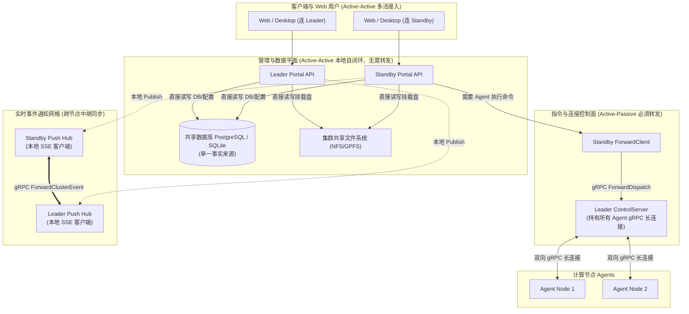
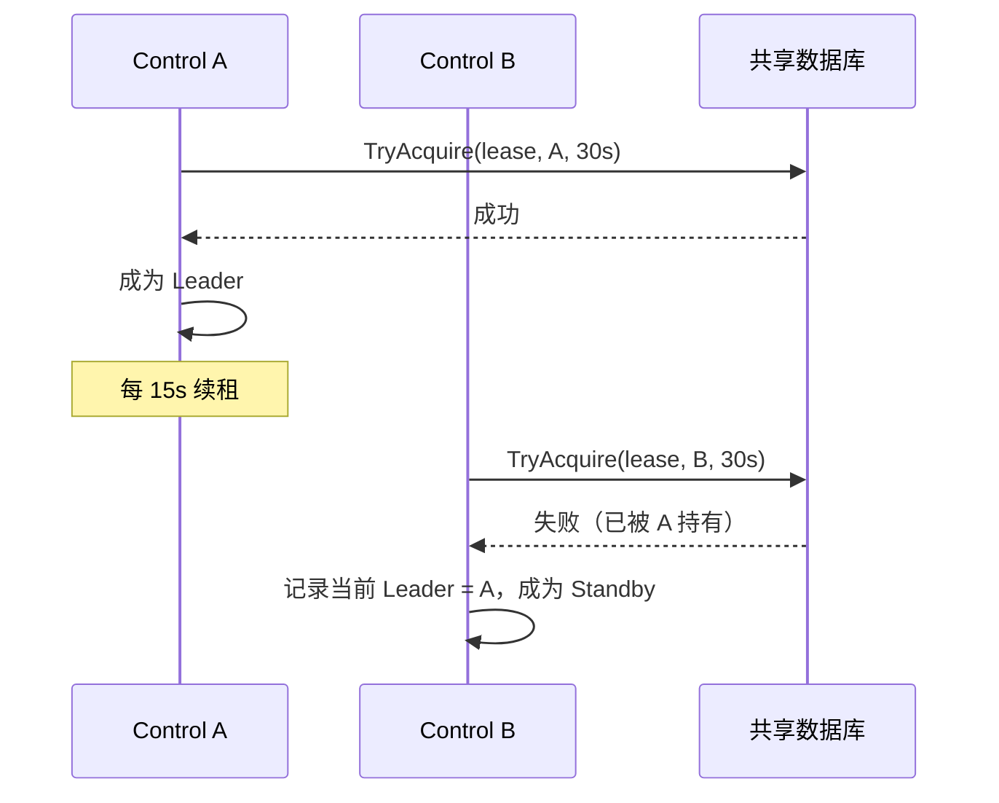
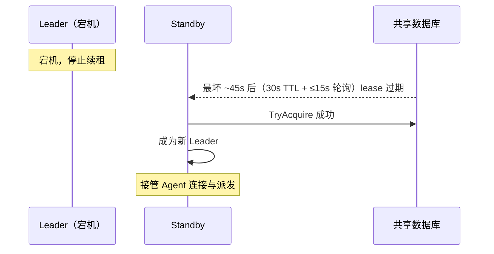
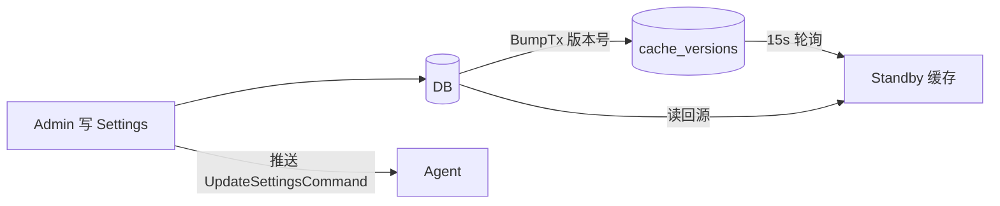
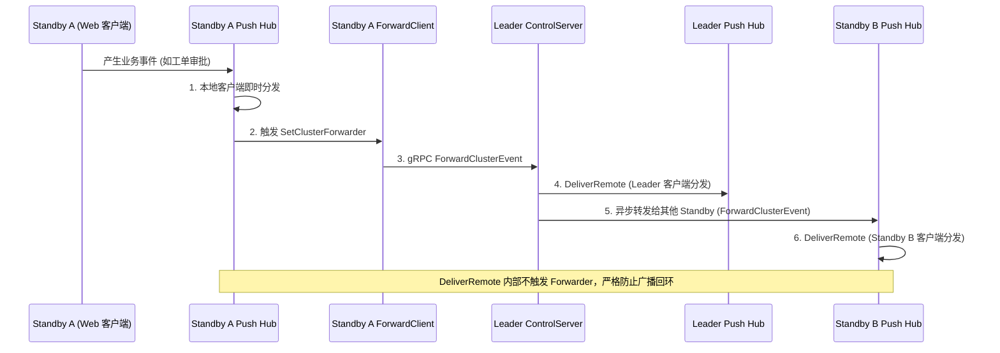

> 本文档系统介绍多 Control 节点（主备）部署下的拓扑、Leader 选举、Agent 连接重定向、
> 请求转发、故障切换与配置同步机制。实现位于 `internal/server/control/` 与 `internal/server/cache/cache.go`。

## 拓扑与角色

### 配置

在 `config.toml` 的 `cluster.servers` 列表中声明多台集群 Server：

```toml
[cluster]
servers = [
  "cn01",                # 集群 Server；元素支持模式展开，如 "cn01", "node[02-03]"
  "cn02",
  "cn03",
]
```

所有匹配 `servers` 项的节点都会启动 Server 角色（Portal + ControlServer）。
多个集群 Server 共享同一个数据库，构成主备（Leader/Standby）集群。

### 角色职责

| 角色 | 职责 |
|------|------|
| **Leader** | 持有所有 Agent 的活跃 gRPC 会话；直接派发任务；接收 Agent 状态上报；读写 DB；广播 Push 事件至 Standby |
| **Standby** | 不直接连接 Agent；接收到的派发请求通过 `ForwardClient` 转发给 Leader；Portal API 全功能服务（直读直写 DB）；向 Leader 同步本地 Push 事件 |

> 只有 Leader 持有 Agent 的活跃 gRPC 会话。Standby 节点的 `AgentRegistry` 通常为空。

---

## 分面治理架构 (Split-Plane Architecture)

DCE 采用经典的**“管理面多活 (Active-Active) + 控制面主备 (Active-Passive)”**分面治理架构：



### 转发与非转发判定矩阵（第一性原理）

系统判定一个操作是否需要跨节点转发，遵循资源所在的底层物理位置：

| 资源所在位置 | 典型业务场景 | 处理模式 | 架构设计考量 |
|:---|:---|:---:|:---|
| **持久化数据 (DB / 共享文件)** | 用户登录认证、密码修改、工单审批、审计日志查询、平台配置修改、应用与桌面连接历史 | **本地直达**<br>(无需转发) | 数据在共享 DB 或共享存储中。所有 Control 节点地位均等，本地直连链路最短、延迟最低、具备原生 ACID 事务保障。 |
| **独立数据拉取流 (DB-backed Pull Stream)** | 看板状态监控 (`/api/dashboard?stream=true`)、本地运行日志拉取 | **本地直达**<br>(无需转发) | 每个节点直接拉取共享 DB 聚合采样并经 `cache.Cell` 缓存下发，不依赖其他节点。 |
| **物理网络连接 (TCP Socket)** | 提交/取消 HPC 作业、启动/停止图形会话、计算节点探针收集、远程进程管理 | **请求转发**<br>(Standby $\to$ Leader $\to$ Agent) | 计算节点 Agent 仅与 Leader 维持 gRPC 长连接。Standby 内存中无该 Agent 的 Socket，必须委托 Leader 代理下发。 |
| **多节点内存状态 (SSE 客户端)** | 节点上下线通知、作业完成弹窗、实时工单状态刷新 (`/api/events`) | **事件中继**<br>(双向中继广播) | 客户端分散连接在各节点的 `push.Hub` 中，本地触发事件后通过 `ForwardClusterEvent` 扩散到其他节点，并带有防回环保护。 |

---

## Leader 选举（DB Lease）

Leader 选举**不是共识算法**，而是基于共享数据库租约（Lease）的"先获取者赢"机制，
实现在 `internal/server/control/leader/leader.go`。

```text
LeaseTaskName  = "cluster_control_plane_leader"
LeaseTTL       = 30s    # 租约有效期
RenewInterval  = 15s    # 续租周期
```

### 流程



### 关键点

- **数据库时间**：到期判断使用 `GetDatabaseTime()` 而非本地时钟，避免节点间时钟漂移导致误判
- **续租**：Leader 每 15s 续租一次，维持 `leaseDeadline = dbNow + 30s`
- **降级**：若续租失败且 `dbNow > deadline`，Leader 主动降级为 Standby（`leader.go`）
- **优雅释放**：`Stop()` 时通过 `ReleaseIfOwner` 主动释放租约，加快切换

## Agent 连接与重定向

Agent **只连接 Leader**。连接管理依赖两类重定向：

### 1. 注册时重定向（Standby 收到注册）

```text
Agent → Standby 注册
Standby 非 Leader
  → 返回 RegisterResponse: leader_node_id / leader_addr
Agent → 重连到 Leader 注册
```

### 2. Leader 降级时主动断开（`server.go:433-437`）

```text
Leader 检测到租约过期/失败 → 降级为 Standby
  → 关闭所有 Agent 流 + 发送 RedirectCommand("leader_demoted")
Agent 收到重定向 → 重连到新 Leader
```

Agent 侧重连采用指数退避（`minReconnectDelay=2s` → `maxReconnectDelay=60s`），
见 `internal/agent/stream.go`。

## 请求转发（Standby → Leader）

Standby 节点接收到需要派发的请求时，由本地 `Dispatcher` 通过 `ForwardClient`
转发给 Leader（`internal/server/control/forward.go`）：

```text
Standby Portal → Standby Dispatcher → ForwardClient → ForwardDispatch gRPC
  → Leader ControlServer → Agent
```

1. `Dispatcher` 检测本节点非 Leader（当前 Leader 记录在共享数据库）
2. `ForwardClient` 通过 `ForwardDispatch` gRPC 接口将请求传递给 Leader
3. Leader 按路由策略选择 Agent 执行，结果沿调用链原路返回

Standby 转发失败时，`RunModeAsyncTracked` 请求会按 `execution_id` 回查 DB
（见 [执行幂等性](execution-idempotency.md)）。

## 故障切换



### 切换时间线

| 事件 | 耗时 |
|------|------|
| Leader 宕机，停止续租 | 0s |
| 原租约过期（`LeaseTTL`） | 30s |
| Standby 轮询发现可获取（`RenewInterval` 粒度） | ≤15s |
| **最坏切换延迟** | **~45s** |

> 切换后，原 Leader 已连接的 Agent 会因 gRPC 流断开自动重连到新 Leader；
> 若是优雅降级，则通过 `RedirectCommand` 主动引导，更快收敛。

## 配置同步（Invalidator 轮询）

多个 Server 节点各自维护一份 Settings 内存缓存。为保证 standby 接管时缓存不陈旧，
使用 `internal/server/cache/cache.go` 的 `Invalidator` 做跨节点失效：

```go
// settings.go: NewService
invalidator.Register("settings", func() {
    s.cache.Clear()  // 版本变化 → 清缓存
})
```

- **写节点**：`UpdateByDomain` 写 DB 时 `BumpTx` 自增版本号 + 本地 `cache.Invalidate(d)` 即时生效
- **其他节点**：`Invalidator` 单 goroutine 按统一节拍（15s）拉取整张 `cache_versions` 表，检测到版本增长 → 触发该主题全部回调（同主题多回调累加，不再互相覆盖）→ 下次读取回源 DB
- **单节点模式**：`Invalidator.Start(ctx, len(Controls) <= 1)` 在单 Control 部署时禁用轮询



### Agent 配置下发（推送）

Settings 更新后，写节点通过 `SetOnUpdated` 注入的广播回调，调用
`BroadcastSettingsUpdate` 将最新配置推送给所有在线 Agent：

```text
updateSettingsByDomain 写 DB
  → broadcastFn(ctx)（异步 goroutine）
    → BroadcastSettingsUpdate
      → 遍历在线 Agent → UpdateSettingsCommand → Agent 内存更新
```

## 跨 Control 节点 Push 消息广播网格

在多 Control 节点拓扑下，前端 Web/桌面客户端可能分别连入 Leader 或不同的 Standby 节点。为了让任一节点产生的业务事件（如工单审批、节点上下线、作业完成）能够无延迟触达所有客户端，系统通过 gRPC 控制平面实现了双向事件中继：



- **Standby 产生事件**：本地 `push.Hub` 投递给本地连接的客户端，同时通过 `ForwardClient` 异步转发给 Leader；
- **Leader 产生/接收事件**：Leader 本地投递后，遍历集群配置中的其他 Standby 节点并行广播；
- **防回环保护**：通过 `DeliverRemote` 接收远端事件，仅在本地内存 `Client` 通道分发，不再次触发 `ClusterForwarder`；
- **单机开发模式**：当集群仅配置单 Control 节点时（`len(Controls) <= 1`），自动跳过跨节点网络调用，保持零开销。

## 推荐部署拓扑

```text
                ┌──────────────┐
                │  PostgreSQL   │  共享数据库（唯一事实来源）
                └──────┬───────┘
                       │
        ┌──────────────┼──────────────┐
        │              │              │
  ┌─────┴─────┐  ┌─────┴─────┐  ┌─────┴─────┐
  │  cn01     │  │  cn02     │  │  cn03     │
  │ (Leader)  │  │ (Standby) │  │ (Standby) │
  │ Portal    │  │ Portal    │  │ Portal    │
  │ Control   │  │ Control   │  │ Control   │
  └─────┬─────┘  └───────────┘  └───────────┘
        │ gRPC (Agent 只连 Leader)
   ┌────┴────┐
   │ Agents  │  计算节点（Agent 角色）
   └─────────┘
```

- 管理节点（`controls` 列表）承担 Server 角色，计算节点承担 Agent 角色
- Agent 经负载均衡/首连任一 Control，注册后被重定向到当前 Leader
- 单机开发：单 Control（`len(Controls) <= 1`），轮询与选举降级为本地直连
