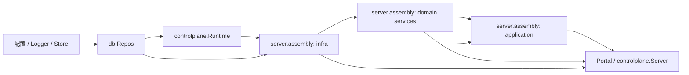

本文说明 Server 如何构造对象图、各层如何协作，以及如何管理后台服务的生命周期。数据库 Repo、事务、分页和缓存实现见[存储与缓存](../architecture/domains/storage-and-cache.md)。

## 组合根与构造顺序

Server 的主要组合根是 `internal/server/server.go` 与 `internal/server/assembly.go`。依赖在服务对外启动前一次构造完成；运行期间不回填或替换服务依赖。



实际构造顺序由 `server.NewServer` 和 `newAssembly` 决定：创建 Store 与 Repo 集合，构造 controlplane Runtime，再构造基础设施、领域服务和应用用例，最后将所需业务端口交给 Portal 与 controlplane.Server。`db.NewRepos(store)` 在 Server 主链路只调用一次。

`assembly` 中的 `infra`、`domain`、`application` 是组合根内部的依赖分组，不是要求每个业务包都按相同名称拆成三层。离线 CLI、开发种子初始化等独立入口可以构造自己需要的最小对象图。

## 依赖方向

| 组件 | 可以依赖 | 边界 |
|---|---|---|
| Portal Handler | 应用用例、领域服务、入口适配所需契约 | 负责 HTTP 鉴权、绑定、状态码和响应转换；不直接访问 Repo 或 Store |
| Application | 多个领域服务；聚合查询可直接读取只读 Repo | 组合完整用例或跨域读模型；不拥有领域持久化状态，也不处理 HTTP/gRPC |
| Domain Service | 自身 Repo、平台能力、窄接口及必要的单向领域服务调用 | 拥有单域规则；不得直接读写其他领域的 Repo |
| Repo | Model、数据库连接与事务能力 | 持久化实现，不承担业务流程编排 |
| Composition root | 各层具体实现与配置 | 唯一负责选择实现、连接依赖和启动生命周期的位置 |

依赖应保持指向稳定能力的方向。入口可以直接调用单域 Service；单向跨域读取也可以直接依赖目标 Service。只有跨域写流程、失败策略需要统一表达，或需要形成面向页面/API 的跨域查询投影时，才增加 application 用例。

### 跨域调用的选择

- **单向读取**：调用方直接依赖被调用域的公开查询方法即可，例如 `session` 读取 `user` 信息。无需仅为“分层整齐”增加 application 转发。
- **跨域写入**：由 application 按业务顺序调用多个领域服务，并在用例处明确失败处理策略。例如身份管理用例位于 `internal/server/application/identity`。
- **领域内必要的反向副作用**：优先提取消费方拥有的窄接口，由组合根注入实现。会话失效组件 `session.Evictor` 被共享注入，避免 `user` 与 `session` 互相导入。
- **真正的依赖环**：先判断职责或所有权是否放错；仍需反向通知时，再通过消费方定义的接口、事件或显式回调解除环。不要为了假设中的双向需求预先引入通用事件总线。
- **跨进程协议**：使用 `internal/contract` 中稳定、中立的契约；不要把服务实现类型或数据库 Model 暴露成通信契约。

### Application 的准入边界

`internal/server/application` 是用例和查询投影的归属，不是所有服务的必经代理层：

- `identity`：把跨用户、角色、会话等服务的写操作组合成完整用例。
- `overview`、`system`：组合多个只读来源形成面向界面的聚合结果。
- 单域 CRUD、校验、状态变更仍归领域 Service。
- 只调用一个 Service、没有新增策略或结果模型的转发方法不应放入 application。

新增 application 代码前，应能指出它所实现的跨域业务顺序、部分失败策略或聚合查询模型。否则应由入口直接调用已有 Service。

## 构造环与端口

当前 controlplane 与业务服务通过明确的构造阶段连接，不在启动后相互回填：

1. `controlplane.NewRuntime` 构造调度与执行运行时，不持有 Portal 业务服务。
2. 领域服务从 Runtime 接收执行、采集触发或设置推送等所需能力。
3. `controlplane.NewServer` 在创建 gRPC Server 时接收设置、告警、事件发布、桌面处理和证书钩子等业务端口。

服务消费一个能力时，优先在消费方定义小接口，由装配根传入实现。只有契约确实跨越 controlplane 与 service 等多个边界并需要中立共享时，才放入 `internal/contract`。

用户与会话失效的共享组件按 `session.Evictor → user.Service → session.Service` 的顺序构造。`user` 依赖自身声明的 `SessionRevoker` 能力，不导入 `session` 实现包。

## 生命周期

- 构造函数负责校验必需依赖，并返回可操作的对象；缺失依赖应在构造期暴露，不留到请求或后台循环中才失败。
- Server 的组合根统一启动和停止有生命周期的组件，包括 HTTP/gRPC Server、缓存失效轮询器、后台任务和控制面运行时。
- `Start` 返回前应完成必要的初始化；启动中途失败时，清理已经成功启动的组件并保留原始错误。
- `Stop`/`Close` 应可重复调用或明确保证只调用一次；停止后台循环后再关闭其依赖的数据库、日志或连接资源。
- 组件的并发启动、取消、超时与错误收集遵循其实际所有者；不要让业务 Service 暗中创建无法停止的 goroutine。

具体组件及启动顺序以 `internal/server/server.go`、`internal/server/assembly.go` 和相应 `Start`/`Stop` 实现为准。

## 边界验证与按需导出

依赖方向由 [`.agents/rules/arch-rules.yaml`](../../../.agents/rules/arch-rules.yaml) 约束，提交门禁用 `python3 .agents/verifiers/verify-arch.py` 对当前 `go list` 依赖图做 fail-closed 检查。

若需要查看当前包规模、`service/*` 跨域 import、组合根下游或指定调用点，可按需运行：

```bash
python3 .agents/scripts/export_arch_graph.py
python3 .agents/scripts/export_arch_graph.py --output /tmp/arch-graph.md
```

未指定 `--output` 时写入标准输出。导出结果会随代码变化迅速过期，仅供即时查看，不要作为仓库中的跟踪文件。该脚本不是门禁；日常以 `verify-arch.py` 为准。
