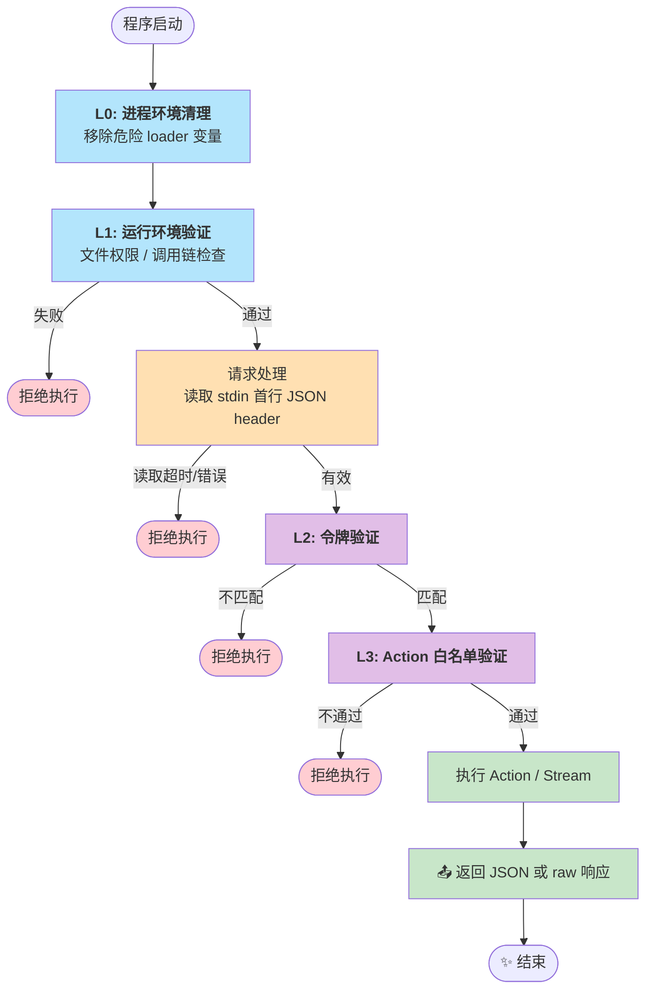

dc-launcher 是 Agent 调用的本地特权执行器，负责执行需要提升权限的系统操作。

> [!NOTE]
> `dc-launcher` 仅支持 **Linux**。它依赖 Linux 进程模型（`setuid`/`setgid`/`setgroups`）与 seccomp BPF 内核机制。

- **[架构](./architecture)** — 组件角色、通信协议、执行模式
- **[动作](./actions)** — 支持的 Operation 列表与参数
- **[安全](./security)** — 纵深防御机制、Token 校验、seccomp 策略

## 执行流程

Launcher 的执行流程采用"快速失败"策略，在不同阶段进行相应的安全验证：



### 流程特点

- **快速拒绝**: L1 启动验证在读取请求前完成，非法调用者无需等待
- **独立验证**: 任何一层失败都会立即退出，不会继续后续步骤
- **全程审计**: 每个关键步骤都记录审计日志
- **时序优化**: 不依赖请求的验证（L1）先执行，最大化早期拒绝效率

## 安全验证层级

Launcher 采用 **L0 进程环境清理 + L1-L4 纵深防御**：

| 层级 | 名称           | 验证内容                           | 验证时机              |
|----|--------------|--------------------------------|-------------------|
| L0 | 进程环境清理       | 立即清理继承的危险 loader 变量            | 进程启动后立刻           |
| L1 | 运行环境验证       | 文件权限、调用者 UID、父进程、父进程可执行文件、运行环境 | 读取请求前             |
| L2 | 令牌验证         | Token 与私有 token 文件常数时间比对       | 解析请求后             |
| L3 | Action 白名单验证 | Action 是否允许经 launcher 执行       | 执行前               |
| L4 | 系统调用隔离       | seccomp-BPF 过滤器                | 身份切换后、handler 执行前 |

详细的安全机制说明请参考 [启动器安全](./security.md)。

## 请求格式 (`ExecuteInput` / `ExecuteOutput`)

### 输入（stdin）

所有请求都会先发送一行 `execution.ExecuteInput` JSON header，并以换行结束；对 `FILE_UPLOAD` 来说，raw body 紧跟在这行之后。

```json
{
  "token": "Q8qGvP0g0w1z2A3b4C5d6E7f",
  "request": {
    "traceId": "trace-123",
    "executionId": "req-123",
    "actionName": "FILE_LIST",
    "targetUser": "alice",
    "payload": {
      "dir": "/home/alice"
    }
  }
}
```

- `actionName`：Action 常量名
- `targetUser`：目标用户模式（`PrivilegeTargetUser`）及特定特权动作（如 `VNC_CGROUP_CONTROL`）必须提供
- `env`、`timeout` 等字段为可选项，位于 `request` 内

### 输出（stdout / stderr）

**普通 Action / `FILE_UPLOAD` 成功响应：**

```json
{
  "success": true,
  "output": "operation result"
}
```

**普通 Action / `FILE_UPLOAD` 失败响应：**

```json
{
  "success": false,
  "error": "error message"
}
```

`FILE_DOWNLOAD` 成功时直接把原始文件字节写到 stdout；失败时仅 stderr 输出 JSON 错误。

> **输出大小限制**：Agent 对普通 JSON 响应的 stdout 最多捕获 **16 MiB**；若超出该限制，执行视为失败并返回错误。
> stderr 最多捕获 **4 MiB**，超出部分静默丢弃。`FILE_DOWNLOAD` 的 raw 文件流不受该 JSON 响应限制约束。

### 审计日志

Launcher 不直接输出审计日志。所有审计事件由调用它的 Agent 所在 Engine 进程在接收到 Launcher 响应后，结合上下文信息统一记录到审计日志系统中。

## 支持的 Operation

参考 [启动器动作](./actions.md)。

## 部署要求

1. **文件权限**
    - launcher 二进制文件 group 和 other 不得有任何权限位；推荐权限为 `700`（仅 owner 可读写执行）
    - 文件所有者应与运行 engine/agent 的系统用户一致

2. **令牌文件**
    - 路径：`/run/user/<uid>/design-cloud-engine/dc-launcher.token`；若 `/run/user/<uid>` 不存在，则回退到
      `/tmp/design-cloud-engine-<uid>/dc-launcher.token`
    - 格式：`crypto.GenSecret(24)` 生成的 24 字符 URL-safe secret（不是 UUID）
    - 权限：目录严格为 `0700`，文件严格为 `0600`，且所有者必须是运行该 Agent/Engine 的系统用户

3. **环境要求**

    - 必须由 Agent 通过授权路径调用，或由 Engine 文件流式服务经受信父进程路径直接调用（见 [安全模型](./security.md) §1.2）；不能从 Shell 直接启动

## 开发模式

开发版本 (launcher-dev) 与常规构建执行完全相同的 L0-L4 安全校验，差异仅在于输出文件名
（`build/dc-launcher-dev`）与 `-tags=dev` 构建标签；版本号注入与正式版一致（纯净 semver），
git 短 hash 经 `COMMIT` 变量单独注入。

### 编译开发版本

```bash
# 使用 Makefile（推荐）
make launcher-dev

# 或手动编译
go build -tags=dev -o dc-launcher-dev ./cmd/launcher
```

### 使用方式

当前 `launcher-dev` 的运行方式与正式版一致，仍需满足真实 token、受信父进程和文件权限等校验。下面仅展示请求 header 的结构示例：

```json
{
  "token": "<launcher-token>",
  "request": {
    "traceId": "trace-123",
    "executionId": "req-123",
    "actionName": "FILE_LIST",
    "targetUser": "alice",
    "payload": {
      "dir": "/home/alice"
    }
  }
}
```

### 安全检查差异

| 检查项                  | 生产版本 (`make launcher`) | 开发版本 (`make launcher-dev`) |
|----------------------|------------------------|----------------------------|
| 进程环境清理（L0）           | 启用                     | 启用                         |
| 文件权限 / 调用链验证（L1）     | 启用                     | 启用                         |
| Token 验证（L2）         | 启用                     | 启用                         |
| Action allowlist（L3） | 启用                     | 启用                         |
| seccomp（L4）          | 启用                     | 启用                         |

**说明**：

- `make launcher-dev` 当前主要用于生成本地调试命名的二进制（`build/dc-launcher-dev`）
- 如果需要放宽校验，需要显式修改代码；仅添加 `-tags=dev` 不会自动跳过任何安全检查

## 相关文档

- [启动器安全](./security.md) - 详细的安全机制和验证流程
- [启动器动作](./actions.md) - 支持的 action 和参数说明
