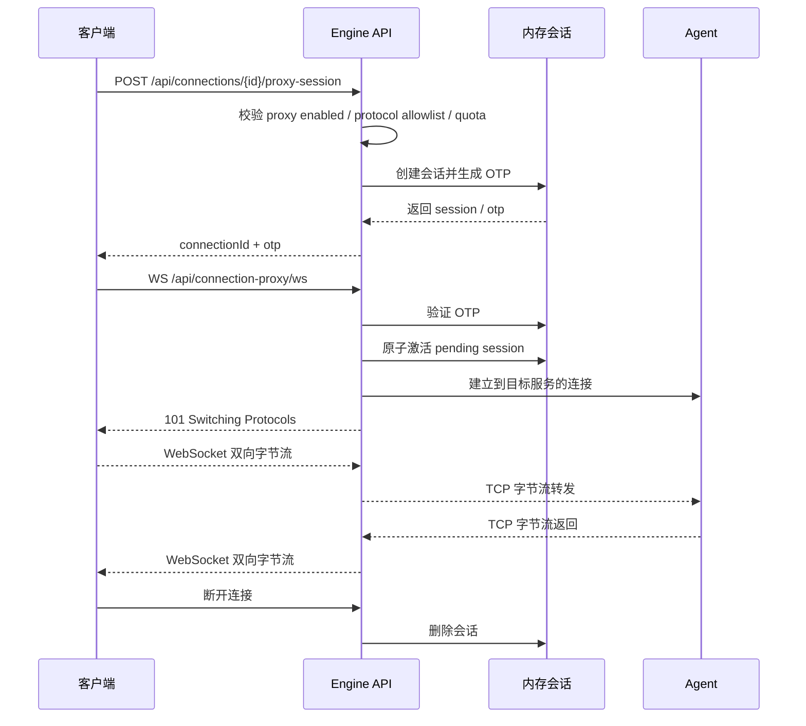

> 协议细节和 API 示例见本文档下文，两种接入方式的概念对比见 [远程访问设计](./connection-model.md)。

Design Cloud Engine 的协议代理服务，会把客户端通过 WebSocket 接入的连接代理到目标服务器的各种协议服务（VNC、RDP、SSH 等）。

- `Proxy session` 是运行时会话，只存在于当前节点的内存中
- OTP 是一次性令牌，只允许消费一次
- 代理链路异常或节点故障后，客户端必须重新申请新的会话/OTP

> 本文的 OTP 是 Engine proxy 会话令牌，只用于 `/api/connection-proxy/ws` 鉴权；direct VNC Viewer 使用的 TurboVNC 协议层
> OTP 由 `POST /api/connections/:id/vnc-otp` 按需生成。

## 配置

Tunnel 配置为**运行时设置**，通过管理 API 维护在数据库中，不在 TOML 配置文件中定义。

| 设置项                  | 所属分组  | 说明                                 |
|----------------------|-------|------------------------------------|
| `enabled`            | tunnel | 是否启用代理功能                           |
| `maxTunnels`         | tunnel | 全局最大并发代理隧道数（0=不限制）；配额按 `pending` + `active` 合计——已签发未消费的 OTP 同样占用名额 |
| `vncEnabled`         | tunnel | 是否允许建立 VNC 协议隧道，默认 `true`       |
| `rdpEnabled`         | tunnel | 是否允许建立 RDP 协议隧道，默认 `true`       |
| `sshEnabled`         | tunnel | 是否允许建立 SSH 协议隧道，默认 `true`       |
| `maxTunnelsPerUser`  | tunnel | 单用户最大代理隧道数                         |
| `otpTTL`             | tunnel | Pending OTP 有效期（秒），默认 1800         |

各常量值（如 WebSocket 缓冲区大小 `32768`、Ping/Pong 间隔等）在源码中硬编码，不对外开放配置。

## 支持的协议

- VNC
- RDP
- SSH

> **注意：** 被代理的 connection 记录必须有明确的 `protocol`、`host` 与 `port`。Proxy 服务会在创建代理会话时快照这些目标字段；后端内部通过
`Tunnel` 运行时对象保存该快照（状态机为 `pending` → `active`）。后续 OTP 认证阶段不依赖 connection DB 回查；它不提供隐式的默认端口或协议回退。
> 如果 connection 的 `protocol` 未在 tunnel 设置中启用（如 `vncEnabled=false`），Proxy 服务不会签发 OTP。

## 特点

- 复用 Portal API 端口，无需额外防火墙配置
- 支持浏览器和桌面客户端
- 通过 OTP 令牌认证
- 代理会话统一复用 Portal 端口，不分配动态代理端口
- 协议处理器可扩展，支持添加新协议

## 运行时状态

- Proxy 会话不写入数据库，也不保留历史记录
- 内存中维护 `connectionId -> session` 与 `otp -> connectionId` 两个索引（实现上使用 `Tunnel` 运行时对象）
- 目标 Host 解析策略：若 Connection 记录的 `Host` 为空、`127.0.0.1` 或 `localhost`，则自动回退使用 `TargetNodeID` 作为拨号目标主机，以支持单机模式与跨节点调度场景
- 重复为同一个 connection 创建会话时，新 OTP 会覆盖旧会话
- WebSocket 断开、后端连接失败或显式关闭时，按 `connectionId` 删除内存会话
- 过期清理有三层：CleanupService 周期性调用 `PruneExpiredPending`；隧道存储在读取路径上以最多 30s 的节流频率惰性剔除过期
  pending 会话；active 会话在 WebSocket 断开时由代理链路主动删除

## 流程



## API 示例

**创建代理会话**

```http
POST /api/connections/{id}/proxy-session
Authorization: Bearer <token>

Response:
{
  "connectionId": 123,
  "status": "pending",
  "expiresAt": "2026-03-23T12:00:00Z",
  "otp": "sK3mNpQwRtYu8vXz2aB4cD"
}
```

常见错误语义：

- `400 Bad Request`：连接缺少可代理的协议、目标主机或目标端口，或协议不受支持
- `403 Forbidden`：连接协议对应的开关未启用（如 `vncEnabled=false`）
- `429 Too Many Requests`：达到全局会话上限，或达到单用户会话上限
- `503 Service Unavailable`：当前未启用 tunnel 服务（`tunnel.enabled=false`）

**连接 WebSocket**

```
wss://<current-portal-origin>/api/connection-proxy/ws
```

客户端使用当前 Portal API origin 发起 WebSocket 连接。认证载荷只需要 OTP；服务端通过 OTP 查到内存会话，再用会话快照的协议、主机和端口连接最终目标。

**WebSocket 端点错误语义**（注意：后端拨号发生在 WS 升级之前，升级失败同样会关闭已激活的隧道）：

- `400 Bad Request`：缺少认证 token、未定义 WebSocket 子协议、无法解析目标 host 或目标端口非法
- `401 Unauthorized`：`Invalid token` / `Token already used`（OTP 已被消费）/ `Token is no longer valid`（隧道已过期或被替换）
- `502 Bad Gateway`：到目标服务的后端拨号失败（此时该隧道会被强制关闭，需重新申请）

## 安全机制

1. **短期 OTP**：会话创建后返回短期 OTP，建立 WS 连接时校验
2. **一次性消费**：只有 `pending` session 能被消费；`active` / `expired` token 都会被拒绝
3. **更安全的 token 传递**：优先使用 `Authorization` 或 `Sec-WebSocket-Protocol`，避免把 OTP 放在 URL query string 中
4. **Origin/Host 校验**：WS 升级请求执行 DNS-rebinding 防护——非浏览器形态放行空 Origin；受信白名单包含 `wails://`
   与 localhost；其余要求 `https://<portalHost>` 来源且 Host 头与监听地址匹配

## 客户端集成

客户端统一通过 WebSocket 建立代理连接。

原生 GUI / 非浏览器客户端（如 C# Avalonia, Electron 等）推荐：

```http
GET /api/connection-proxy/ws
Authorization: Bearer <otp>
```

**本地 TCP 桥接架构 (Local Port Forwarding) 最佳实践**：
如果你的客户端程序需要调用原生的第三方库（例如 `SSH.NET`、调起 `mstsc.exe`），建议采用在本地启动临时网关的架构：

1. 客户端不仅与 Server 建立如上的 HTTPs/WSS 代理会话。
2. 客户端在 `127.0.0.1` 侧向操作系统申请一个随机端口（如 `127.0.0.1:50000`）并启动 `TcpListener`。
3. 当本地的原生库（如 `SSH.NET`）连接该端口时，客户端程序在后台启动双向循环（如 C# 中的 `Stream.CopyToAsync` 或 Go 中的
   `io.Copy`）。
4. 将 `TcpClient.GetStream()` 获取的本地 TCP 流与后端的 `ClientWebSocket` 流无缝对接。

这种形态不仅能绕过浏览器沙箱，让重型后端库在前端稳定工作，还能最大程度保持协议库本身的生态完整。

浏览器 / WebView 推荐：

```javascript
const ws = new WebSocket(
  \`${portalWsOrigin}/api/connection-proxy/ws\`,
  [`dc-proxy-token.${data.otp}`],
);
```

原因：

- 浏览器原生 `WebSocket` API 不能像 `fetch` 一样自由设置自定义请求头
- `Authorization` 在浏览器 WebSocket 握手里通常不可控
- `Sec-WebSocket-Protocol` 是浏览器原生支持、又不会把 OTP 暴露在 URL 里的更稳妥选择

客户端通过 Header 或 `Sec-WebSocket-Protocol` 传递凭据：

```javascript
const response = await fetch('/api/connections/' + id + '/proxy-session', {
  headers: { 'Authorization': 'Bearer ' + token }
});
const data = await response.json();

const ws = new WebSocket(
  `${portalWsOrigin}/api/connection-proxy/ws`,
  [`dc-proxy-token.${data.otp}`],
);
```

## 集群与重连语义

- 集群部署时，前端连接当前 Portal API origin，由后端完成节点内代理校验和转发
- 已建立的 WS 连接如果因为节点故障、网络异常或后端服务不可达而中断，该会话会结束
- 客户端不得复用已消费的 OTP 重试；应重新调用 `POST /api/connections/{id}/proxy-session` 获取新的会话和 OTP

## 会话管理

### 查询会话

```http
GET /api/connections/{id}/proxy-session
Authorization: Bearer <token>

Response:
{
  "connectionId": 123,
  "status": "active",
  "expiresAt": "2026-03-23T12:00:00Z"
}
```

### 关闭会话

```http
DELETE /api/connections/{id}/proxy-session
Authorization: Bearer <token>
```

如果当前连接没有活跃 proxy 会话，接口返回 `404 Not Found`。

## 设计取舍

- 对外暴露 Portal 端口，由 Portal 统一承载 协议代理入口
- 前端协议固定，客户端使用当前 Portal API origin 建立 WS
- 节点故障后采用“重新申请新 session”而不是迁移既有连接，保持状态机清晰且可验证
- 协议处理器抽象允许支持多种协议（VNC、RDP、SSH 等），统一使用 32KB 内存池缓冲与 `coder/websocket` 进行安全流式转发
- 标准 VNC 客户端直连已支持：前端通过 `GET /api/connections/:id` 获取节点 `host:port`，通过
  `POST /api/connections/:id/vnc-otp` 获取一次性密码，即可使用标准 VNC 客户端直接连接。后端无需额外改造。
