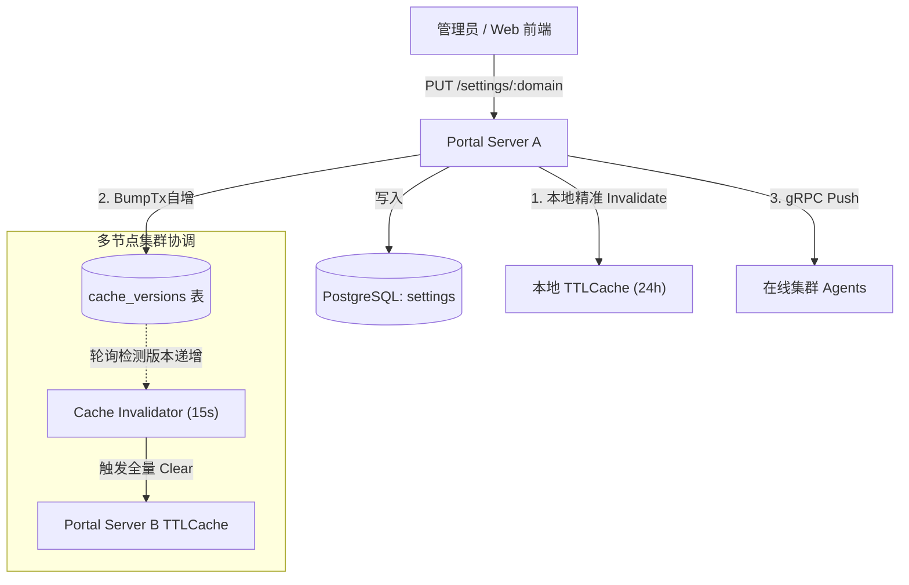

本文档定义设计云平台运行时系统设置（Settings）的架构基线、设计原则与实现规范，供后端维护扩展与客户端对接参考。

---

## 1. 架构定位与设计哲学

设计云平台的配置体系划分为两大正交层次：

1. **静态启动配置 (`config.toml`)**：
   进程冷启动参数（监听地址/端口、数据库连接串、LDAP 绑定凭据、调度器脚本路径等），仅在服务启动时从本地文件读取，不支持热更。
2. **动态系统设置 (`Settings`)**：
   运行期业务配置（认证安全策略、会话 TTL、各子系统缓存时间、告警阈值、Launcher 路径、VNC 与监控采集参数等）。统一持久化于数据库，支持在线修改、多节点缓存失效与向 Agent 实时推送。

### 核心设计原则

- **单一事实来源 (Single Source of Truth)**：
  后端 Go 结构体（`internal/server/service/settings/schema/types.go`）及其结构体标签（`json:"..."`, `validate:"..."`）与 `defaults.go` 是配置字段、默认值及校验约束的唯一权威源。
- **零历史兼容**：
  坚决不引入配置别名、fallback 兜底分支或多版本嗅探。重构即全量对齐，废弃字段直接硬清理。
- **Schema 驱动前端动态表单**：
  后端提供标准 JSON Schema API 暴露字段树与取值约束，前端据此自动生成管理界面与输入限制，杜绝前端硬编码配置模型。

---

## 2. 13 个业务设置域划分

系统设置按**业务语义**收敛为 **13 个正交域**（每个域对应 `settings` 表一条记录、一个缓存键、一个 `/api/admin/system/settings/:domain` 管理端点）：

| 域 (`domain`) | 职责范围与核心字段 | 消费方 |
|---|---|:---:|
| **`platform`** | 平台品牌元信息（名称、描述）、Portal 网站开关（主页及大屏启用状态） | Portal / Web |
| **`auth`** | 会话生命周期（`sessionTTL`、`sessionCleanupInterval`）、防爆破规则（锁定阈值与封禁时长）、用户同步间隔、UID/GID 映射缓存 TTL | Portal / User |
| **`connection`** | 远程桌面连接全局配额（`maxConnectionsPerUser`）、活跃连接列表缓存 TTL | Portal / Connection |
| **`tunnel`** | 远程访问网络隧道配置：各协议原生与代理开关（`vncEnabled`、`rdpEnabled`、`sshEnabled`）、OTP 验证码有效期 | Portal / Proxy |
| **`file`** | 文件管理总开关（`enabled`）、上传/下载控制及配额、审批失效期、自定义额外文件存储位置列表 (`locations[]`) | Portal / File |
| **`dashboard`** | 监控大屏各类资源指标刷新周期（节点状态、算力资源、调度器队列、存储），存储容量采样回溯窗口 | Web Dashboard |
| **`storage`** | 全局共享存储集群挂载点配置 (`storages[]`) 及周期探测间隔 (`probeInterval`) | Portal / Storage |
| **`scheduler`** | 作业调度系统查询缓存时间 (`jobCacheTTL`) | Scheduler / Execution |
| **`license`** | 浮动许可证服务监控缓存时间 (`statusCacheTTL`, `featuresCacheTTL`)、`lmutil` 工具路径（支持节点覆盖） | License / Agent |
| **`agent`** | **唯一面向 Agent 运行能力的复合域**：底座工具路径 (`launcherPath`)、VNC 服务启动与扫描参数 (`vnc`)、节点资源监控与额外磁盘挂载监听 (`monitor`) | Agent / Launcher |
| **`alert`** | 系统资源告警开关、触发百分比与绝对阈值、冷却时间（CPU、系统负载、内存、本机磁盘、共享存储） | Monitor / Alert |
| **`desktop`** | 客户端发布管理总开关、各操作系统安装包发布使能及保留数量上限 | Portal / Desktop |
| **`cert`** | 集群节点 TLS 证书自动续期策略（提前续期天数、最大重试次数、退避时间阶梯） | Cert / Cluster |

---

## 3. 数据持久化与局部叠加更新

### 3.1 存储模型

数据库模型非常扁平（`internal/model/setting.go`）：
```sql
CREATE TABLE settings (
    domain VARCHAR(64) PRIMARY KEY,
    value  TEXT NOT NULL -- 紧凑 JSON 格式
);
```

### 3.2 局部更新（Patch / Merge）语义

通过 `PUT /api/admin/system/settings/:domain` 更新设置时，采用**安全局部叠加更新**机制：

1. **未携带字段保留现值**：请求体只需携带发生改动的字段（增量 JSON），未携带字段保留现有配置，绝不会被默认值或零值冲掉。
2. **嵌套对象递归叠加**：如更新 `agent` 域下的 `{"vnc": {"scanInterval": 3600}}`，`vnc.binDir` 与 `monitor` 等其他子字段保持原样。
3. **数组整体替换**：数组（如 `storage.storages`、`file.locations`）属于整体策略，更新时以传入的新列表全量覆盖旧列表。
4. **读取侧生效值作为基线**：叠加前先以存量读取值作为基线，存量若残留未知键（如跨版本遗留）会在预处理中剔除。
5. **全量严格校验**：叠加生成的新完整快照，必须 100% 通过 `internal/server/service/settings/schema/validate.go` 的强校验（边界范围、合法枚举、跨字段关联约束）。任一字段不合法则整次操作回滚并返回 `422 Unprocessable Entity`。

---

## 4. 零值语义与持久化约定

Go 结构体标签组合 `allowzero` 与 `omitempty` 决定了数字字段传入 `0` 时的行为：

| 标签模式 | 代表字段 | 传入 `0` 的处理与落库表现 |
|---|---|---|
| **无 `omitempty`**<br>`allowzero` | `userSyncInterval` (auth)<br>`maxConnectionsPerUser` (connection)<br>`*usedPercent` (alert) | **显式 0 原样持久化落库**。<br>业务含义：表达“关闭功能”（如 `userSyncInterval=0` 停止定时同步），或合法的零值配额/阈值。 |
| **有 `omitempty`**<br>`allowzero` | 各类缓存 TTL (`jobCacheTTL`、`connectionListCacheTTL` 等)<br>各种刷新周期 (`resourceReportInterval` 等) | **显式 0 在序列化写库时省略该键**，等效于未携带；<br>`GET` 读取时回退至 Schema 定义的默认值。<br>前端不应将此类字段的 0 当作可保存的“关闭”指令。 |

---

## 5. 节点个性化覆盖与舰队管理

集群中部分节点具备特殊硬件或网络环境（如 GPU 节点、自定义挂载盘、专用 License 工具路径），系统支持节点级个性化覆盖。

### 5.1 覆盖范围限制

为保证集群一致性与拓扑安全，节点覆盖采用**白名单稀疏覆盖**策略，仅允许覆盖 3 个特定子域：
- **`agent`**：允许覆盖 `launcherPath`、`vnc` 启动选项、`monitor.diskMounts`（本机额外挂载盘）；
- **`alert`**：允许针对单机硬件性能覆盖 CPU、内存、本地磁盘告警阈值；
- **`license`**：允许覆盖本机特定版本的 `lmutilPath`。

> 严禁在节点级覆盖 `storage` 等全局集群基础设施。

### 5.2 继承与合并（Effective Settings）

- 节点覆盖存储在 `nodes.node_settings` 字段中（稀疏 JSON）；
- 节点有效配置（`Effective`）：全局配置叠加节点覆盖后的完整融合视图，未覆盖项完全继承全局配置；
- 控制面分发：向 Agent 下发配置或 Agent 本地查询时，始终使用计算出的 `Effective` 配置。

### 5.3 舰队批量更新

通过 `POST /api/admin/system/nodes/settings/batch` 支持集群舰队配置按条件统一覆盖：
- 支持按多维度选择器匹配目标节点：`nodeIds`、`labels`（标签匹配）、`os`（操作系统）、`status`（在线状态）；
- 支持批量应用稀疏 Patch（传 `null` 可清除覆盖并恢复继承全局默认）；
- 提供 `dryRun=true` 预演模式，仅返回匹配节点数与变更快照，不实际落库。

---

## 6. 缓存机制与多节点广播热更

系统设置具备极高的读取吞吐要求，架构采用双层缓存与在线分发保障：



1. **单机高性能读取**：内存采用 `TTLCache[schema.Domain, any]`，默认缓存 24 小时，日常读取完全零 DB 查询。
2. **写路径即时失效**：当前节点发生 `PUT` 写入后，本地缓存立即执行精确域失效（`s.cache.Invalidate(d)`），下一次读取即刻穿透至数据库获取最新值。
3. **集群跨节点广播（多 Server 拓扑）**：
   - 写入事务内原子自增 `cache_versions` 的 `settings` 主题版本；
   - 其他 Server 节点的 `Invalidator` 统一按 15 秒节拍轮询版本表，发现版本跃迁即自动清理全量缓存；
   - 单节点模式下自动停止无效轮询。
4. **Agent 在线热更分发**：
   - 当 `agent`、`alert` 或 `license` 发生改动时，控制面触发 `broadcastFn`，通过既有 gRPC 双向流即时向已连接的活跃 Agent 推送全量 `pb.AgentSettings` 变更命令，实现免重启参数热更。

---

## 7. Schema 驱动的前端动态渲染与预校验

前端界面（Web 门户或桌面管理控制台）**无需为每个配置字段手动硬编码 UI 结构与校验规则**，完全通过后端的 Schema 体系实现自动化渲染：

### 7.1 Schema API 清单

| 端点 | 方法 | 鉴权要求 | 说明 |
|---|:---:|---|---|
| `/api/admin/system/settings/domains` | `GET` | System Admin (`ScopeSettings`) | 获取当前系统支持的 13 个设置域列表 |
| `/api/admin/system/settings/:domain/schema` | `GET` | System Admin (`ScopeSettings`) | 获取指定域的标准 JSON Schema 结构定义 |
| `/api/admin/system/nodes/:id/settings/schema` | `GET` | System Admin (`ScopeNodes`) | 获取指定节点的覆盖配置 JSON Schema 定义 |

### 7.2 Schema 元数据能力

后端通过反射解析 Go struct 标签，动态生成标准的 JSON Schema 输出：

```json
{
  "type": "object",
  "properties": {
    "scanInterval": {
      "type": "number",
      "default": 1800,
      "minimum": 60,
      "maximum": 86400,
      "allowZero": true
    },
    "nvidiaSmiPath": {
      "type": "string",
      "default": ""
    }
  }
}
```

- **类型展开**：递归展开 `object`、`array` 与基础标量类型；
- **默认值与水印**：输出各字段在代码层定义的权威 `default` 值，供前端控件展示占位符与初始值；
- **边界约束与枚举**：直接在 Schema 属性中下发 `minimum`、`maximum`、`enum` 与 `allowZero`；
- **敏感字段保护**：密码或凭据类字段不会在 Schema 或 GET 中明文回传。

### 7.3 前端工作流最佳实践

```
1. 导航构建：
   调用 GET /settings/domains 获取 13 域清单，动态渲染左侧管理菜单。

2. 页面载入：
   用户切换至某域时，并发调用：
     - GET /settings/:domain/schema （获取结构定义与约束）
     - GET /settings/:domain        （获取当前实际值）

3. 表单渲染与即时校验：
   - 依据 schema.properties 的结构递归生成表单控件；
   - 依据 schema 中的 minimum / maximum 限制数值输入范围；
   - 依据 schema 中的 enum 渲染下拉框选项；
   - 依据 schema 中的 default 展示缺省值或 Watermark 占位符。

4. 变更提交：
   - 监听表单改动，仅序列化用户实际发生变更的字段（增量 JSON）；
   - 发送 PUT /settings/:domain；
   - 响应 204 说明保存成功，重新拉取当前值刷新展示；
   - 响应 422 解析后端返回的结构化错误提示，展示在相应字段旁。
```
