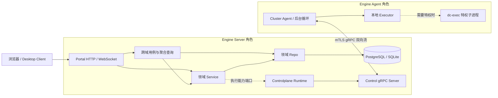
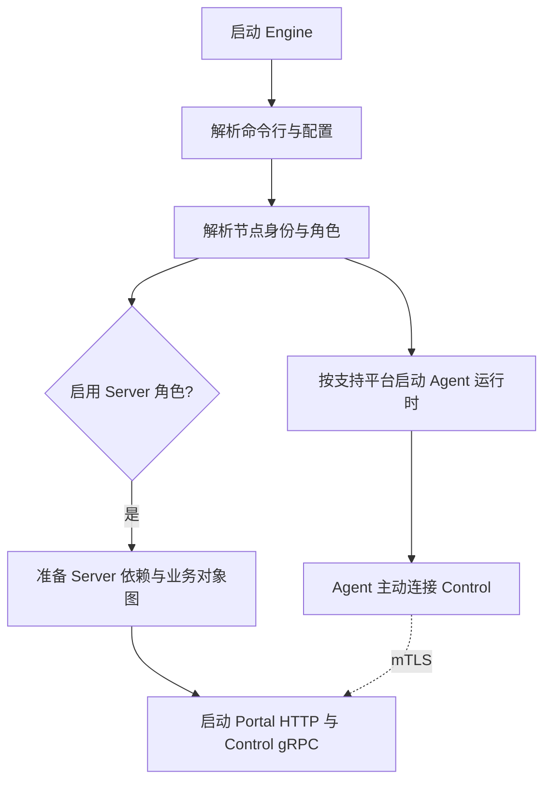

本文介绍 Design Cloud Engine 的运行时组成和节点角色。源码分层、依赖规则与对象归属见[依赖装配](../development/dependency-wiring.md)；数据库和缓存机制见[存储与缓存](../architecture/domains/storage-and-cache.md)。产品定位与能力矩阵见[系统总览](./_index.md)。

## 运行时结构

图中 `App` 表示 application 用例或聚合查询，只有跨域编排和聚合读取需要经过该层；普通单域请求由 Portal 直接调用对应领域 Service。Server 的组合根负责把运行时执行能力注入 Service，并把业务端口提供给 Control gRPC Server。Portal 不直接访问数据库或 Agent 执行器。

Agent 主动连接 Control，接收执行请求并在本机运行 Executor。只有需要提权或身份切换的操作才经独立 `dc-exec` 子进程；普通本地操作由 Agent/Executor 直接执行。dc-exec 不是 Control 直接调用的组件，详细 IPC 与安全边界见[启动器架构](/docs/architecture/dcexec/architecture)。

数据库由 Server 侧业务 Repo 访问。Agent 的采集与执行运行时不依赖 Portal Service；配置或执行结果通过 Cluster 协议与 Server 协作。

## 节点角色

Engine 是同一个主程序，可按本机配置和启动模式启用 Server、Agent，Linux 上两种角色可在同一进程共存。

| 角色 | 主要职责 | 运行组件 |
|---|---|---|
| **Server** | 提供用户与管理入口、持有业务服务并接入集群 Agent | Portal、业务 Service、Control gRPC Server、持久层访问 |
| **Agent** | 承接本机探测、资源采集、任务与远程连接执行 | Cluster Agent、Executor、后台采集循环；按需调用 dc-exec |

典型部署方式：

- **单机开发或轻量部署**：Linux Engine 同时运行 Server 与 Agent。
- **分布式集群**：管理节点运行 Server；计算节点运行 Agent 并主动连接 Server。
- **Windows 计算节点**：运行 Agent，不承担 Server 角色；本机动作由 Windows Executor 能力支持。

Server 角色通常由配置中的集群 Server 主机列表与本机身份匹配确定；Configless Agent 则由 Join 启动参数提供集群连接信息。Agent 在受支持节点常驻运行。具体模式判定与参数约束见[配置文件](../deployment/config.md)。

## 启动与请求路径

### Engine 启动

Server 与 Agent 的实际启动入口及失败清理由 Engine 启动器负责。Server 的对象构造顺序和生命周期见[依赖装配](../development/dependency-wiring.md)。

### 一次远程执行

1. 用户或管理端通过 Portal 发起请求。
2. 对应领域 Service 通过注入的执行能力提交任务；必要的跨域步骤由 application 用例协调。
3. Controlplane Runtime 经 Cluster gRPC 将任务发送给目标 Agent。
4. Agent 在本机执行；特权操作由 Executor 通过 dc-exec IPC 完成。
5. Agent 将状态或结果通过 Cluster 协议回传，Server 更新业务状态并向 Portal 查询方提供结果。

Control 与 Agent 的认证、注册和通信细节见[集群协议](../architecture/cluster/protocol.md)与[Agent 运行时](../architecture/cluster/agent.md)。

## 关键边界

- **Portal** 负责 HTTP/WebSocket 协议适配和身份接入，不拥有领域规则或持久化实现。
- **领域 Service** 承载单个业务能力；**application** 仅组合真实跨域用例或查询投影。详见[依赖装配与 Application 边界](../development/dependency-wiring.md#application-的准入边界)。
- **Controlplane** 承载 Server 侧集群协议与运行时调度，通过端口连接业务服务和 Agent，不直接依赖 Portal Handler。
- **Agent** 执行本机任务并采集状态；它通过中立 Cluster 契约通信，不导入 Server 业务实现。
- **DcExec** 是权限边界独立的本地特权桥接进程，不是通用任务执行器。
- **Repo** 负责业务持久化访问；数据库事实源、事务、分页与缓存一致性见[存储与缓存](../architecture/domains/storage-and-cache.md)。
